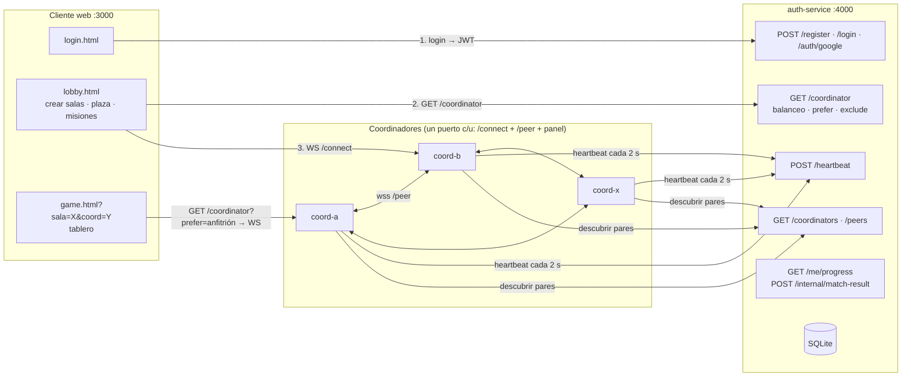

# Cuatro Mundos — Monopoly SD (Proyecto final · Sistemas Distribuidos)

Juego de tablero multijugador en tiempo real. Cuatro mundos comparten el tablero: **Star Wars** (David), **Fantasía** (Jossef), **Vikingos** (Sebastian) y **Literatura** (Santiago). Las **salas las crean los jugadores** y las atiende una red de **X coordinadores en mesh** que puede crecer en caliente.

- **Salas dinámicas**: cualquier jugador crea una sala desde el lobby. La sala queda alojada en su coordinador y se ve desde **todos** los coordinadores.
- **Cambio automático de coordinador**: quien entra a una sala alojada en otro coordinador se cambia solo al anfitrión. Esto vale tanto para jugar como para observar.
- **Balanceo de carga**: el auth-service manda a cada jugador del lobby al coordinador menos cargado y reparte los empates por turnos (10 jugadores y 2 coordinadores quedan 5 y 5).
- **Replicación y tolerancia a fallos**: todas las salas y jugadores se replican. Si el anfitrión de una sala cae, otro coordinador la adopta con su estado.
- **Panel del coordinador**: al arrancar se abre una página con los demás coordinadores de la red y el estado del enlace con cada uno.

> **Tutorial para conectar X coordinadores con ngrok:** [`docs/COORDINADORES_NGROK.md`](docs/COORDINADORES_NGROK.md)

---

## 1. Arquitectura



| Componente | Responsabilidad |
| --- | --- |
| `auth-service/` | Usuarios (bcrypt + JWT + Google). **Directorio de coordinadores y balanceador**: recibe heartbeats, descarta los que llevan más de 6 s sin latir y responde `/coordinator`, `/coordinators` y `/peers`. Guarda el progreso de misiones. |
| `coordinator/` | Atiende a sus clientes por WS, forma la mesh con los demás coordinadores, aloja las salas que crean sus jugadores, replica todo y corre la plaza a 20 Hz. Abre su **panel** en el navegador. |
| `client/` | Login, lobby (crear y listar salas, plaza en canvas, jugadores en línea, colección) y tablero. Pide coordinador al auth antes de abrir cada WS y se reconecta o se cambia de coordinador solo. |

---

## 2. Estructura del repositorio (programación modular)

```text
auth-service/
  index.js                     Arranque: monta las rutas
  src/config.js                Variables del .env
  src/db.js                    SQLite (usuarios, progreso, partidas)
  src/routes/auth.js           /register · /login · /auth/google
  src/routes/directory.js      /heartbeat · /coordinator (balanceo) · /coordinators · /peers
  src/routes/progress.js       /me/progress · /internal/match-result

coordinator/
  index.js                     Arranque
  src/config.js                Línea de comandos + .env
  src/state.js                 Estado en memoria y utilidades de envío
  src/server.js                HTTP: panel, /status, WS /connect, WS /peer
  src/clients.js               WebSocket de los jugadores y sus mensajes
  src/mesh.js                  Enlaces con otros coordinadores y réplica
  src/rooms.js                 Salas creadas por jugadores (anfitrión, réplica, timers, adopción)
  src/broadcast.js             Difusión a los clientes locales
  src/loop.js                  Game loop de la plaza (20 Hz)
  src/directory.js             Heartbeat y descubrimiento de pares
  src/ngrok.js                 Detecta (o lanza) el túnel de ngrok
  src/panel.js                 API del panel y apertura del navegador
  panel/index.html · panel.css · panel.js     Panel del coordinador
  game/                        Motor del juego (no depende de red)

client/
  server.js                    Sirve public/ y genera /js/config.js
  public/login.html · lobby.html · game.html   Solo marcado (sin CSS ni JS en línea)
  public/css/                  styles.css (base) · login.css · lobby.css · game.css
  public/js/lib/               dom.js · net.js · tokens.js · sounds.js (compartidos)
  public/js/pages/             login.js · lobby.js · game.js (uno por página)

docs/  COORDINADORES_NGROK.md · ECONOMIA.md · PLANTILLAS.md
```

---

## 3. Cómo correrlo en local

Requisitos: **Node.js 18+**. Usen la misma `JWT_SECRET` en `auth-service/.env` y `coordinator/.env`.

```bash
# 0) Dependencias (una vez)
cd auth-service && npm install && cd ..
cd coordinator  && npm install && cd ..
cd client       && npm install && cd ..

# 1) Auth-service + directorio
cd auth-service && npm start                 # http://localhost:4000

# 2) Coordinadores (una terminal por cada uno; cada uno abre su panel)
cd coordinator && npm run start:a            # coord-a · http://localhost:5001
cd coordinator && npm run start:b            # coord-b · http://localhost:5002
cd coordinator && npm run start:c            # coord-c · http://localhost:5003

# 3) Cliente web
cd client && npm start                       # http://localhost:3000
```

Cualquier otro coordinador: `node index.js --id coord-x --port 5004`. Con ngrok: `node index.js --id coord-x --port 5004 --ngrok`. Todas las opciones están en el [tutorial](docs/COORDINADORES_NGROK.md#8-referencia-de-opciones-del-coordinador).

| Servicio | Variable | Por defecto | Uso |
| --- | --- | --- | --- |
| auth | `PORT`, `JWT_SECRET`, `JWT_EXPIRES_IN`, `DB_PATH`, `GOOGLE_CLIENT_ID` | | Igual que en talleres anteriores |
| auth | `HEARTBEAT_TTL_MS` | `6000` | Sin heartbeat durante este tiempo → coordinador muerto |
| coordinator | `--id`, `--port`, `--auth-url`, `--public-url`, `--ngrok`, `--no-panel` | | Ver tutorial §8 |
| coordinator | `TURN_TIMEOUT_MS`, `MAX_ROOMS`, `ROOM_EMPTY_MS`, `ROOM_ABANDON_MS` | `90000`, `24`, `60000`, `90000` | Tiempo por turno, límite de salas, borrar sala vacía o abandonada |
| client | `PORT`, `AUTH_URL`, `GOOGLE_CLIENT_ID` | | El cliente **no tiene** URL de coordinador fija |

---

## 4. Endpoints del directorio (auth-service)

### `POST /heartbeat` — cada coordinador, cada 2 s

```bash
curl -X POST http://localhost:4000/heartbeat -H "Content-Type: application/json" \
  -d '{"coordinatorId":"coord-a","publicUrl":"wss://a.ngrok-free.app","peerUrl":"wss://a.ngrok-free.app/peer","connectedPlayers":7,"uptime":12345}'
# 200 {"ok":true}
```

### `GET /coordinator` — balanceador de carga

```bash
curl http://localhost:4000/coordinator                    # el menos cargado
curl http://localhost:4000/coordinator?prefer=coord-a     # coord-a si está vivo (anfitrión de la sala)
curl http://localhost:4000/coordinator?exclude=coord-b    # cualquiera menos el que acaba de fallar
# 200 {"coordinatorId":"coord-b","publicUrl":"wss://b.ngrok-free.app"}
# 503 {"error":"no_coordinators_available"}
```

- **Menos cargado**: según los jugadores del último heartbeat más las asignaciones hechas desde entonces (reserva provisional). Así, si 10 clientes entran en el mismo segundo, no van todos al mismo coordinador.
- **Empates por turnos** (round-robin): con carga igual, se alternan.
- **`prefer`**: lo usa el tablero para ir al anfitrión de la sala. Si ese coordinador no está vivo, se aplica el balanceo normal.

### `GET /coordinators` y `GET /peers`

`/coordinators` lista todos los vivos con carga, uptime y `lastSeenMsAgo`. Lo usan los coordinadores para descubrir pares y para su panel. `/peers` es la versión corta (`coordinatorId`, `peerUrl`).

### Otros

| Endpoint | Para qué |
| --- | --- |
| `GET /me/progress` (Bearer JWT de usuario) | Estadísticas para las misiones de fichas. |
| `POST /internal/match-result` (Bearer JWT de servicio) | El anfitrión de la sala reporta el resultado de la partida. Es idempotente por `matchId`. |

---

## 5. Protocolo de la mesh

Cada coordinador escucha a sus pares en **`<publicUrl>/peer`**, el mismo puerto y el mismo túnel que los clientes. Cada 2 s pide `/coordinators` y abre conexión hacia los pares que aún no tiene.

**Una sola conexión por par.** Solo el coordinador con el id **menor** (orden lexicográfico) inicia la conexión; el mayor espera. Si aun así llega una conexión de un par con el que ya hay enlace, se cierra la nueva (`4009 duplicate peer link`).

**Handshake.** El primer mensaje en cada sentido es:

```json
{ "type": "hello", "coordinatorId": "coord-a", "auth": "<JWT de servicio>" }
```

El campo `auth` es un JWT `{ role: "coordinator" }` firmado con `JWT_SECRET`. Así, un proceso cualquiera no puede meterse a la mesh ni inyectar estado.

**Mensajes replicados** (todos llevan `origin`):

| Mensaje | Cuándo | Qué hace quien lo recibe |
| --- | --- | --- |
| `intent_replicate` `{userId, intent:{dir}, x, y}` | Un cliente local cambia de dirección | Aplica el intent a su copia del jugador |
| `extras_replicate` `{userId, extras}` | Un cliente local cambia color, ánimo o ficha | Actualiza los extras |
| `player_joined` `{userId, username, x, y, view, roomId, since}` | Un cliente se conecta | Agrega el jugador al mundo |
| `player_left` `{userId}` | Un cliente se desconecta | Lo quita, solo si sigue siendo de ese coordinador |
| `positions_replicate` `{positions:[...]}` | Cada 1 s | Corrige la deriva de posiciones |
| `room_state` `{roomId, writer, meta:{name, emblem, host, createdBy}, state}` | Se crea o cambia una sala | Crea la sala si no la conocía y adopta el estado si su versión es mayor |
| `room_deleted` `{roomId}` | El anfitrión borra una sala | La borra y deja una lápida para no resucitarla |

**Sin bucles de replicación**: nadie retransmite lo que recibe, y se descarta todo mensaje con `origin` propio.

**Al enlazarse**, dos coordinadores se mandan sus jugadores locales y **todas** las salas. **Si un par se cae**, los demás retiran a sus jugadores y los marcan desconectados en las salas.

### Game loop de la plaza (20 Hz)

1. Aplica los intents de **todos** los jugadores (locales y remotos).
2. Hace broadcast del `state` **solo a sus clientes locales**.

---

## 6. Salas creadas por los jugadores

1. **Crear**: en el lobby, el jugador escribe un nombre y elige un emblema. El cliente envía `create_room`. Su coordinador crea la sala (`sala-<hex>`), queda como **anfitrión** y la replica a todos. El creador entra directo al tablero.
2. **Ver**: todos los lobbies, en cualquier coordinador, reciben la sala en `rooms_update` con su anfitrión, estado (**Vacía**, **Sin iniciar**, **En curso**, **Finalizada**), asientos, jugadores y observadores.
3. **Entrar u observar**: el lobby abre `game.html?sala=<id>&coord=<anfitrión>`. El tablero pide `GET /coordinator?prefer=<anfitrión>` y se conecta allá. Si el WS llega a otro coordinador, este responde **`4010 host:<anfitrión>`** y el cliente se cambia solo, con el aviso *"Esta sala la atiende coord-a. Cambiando de coord-b a coord-a…"*.
4. **Reglas**: mínimo 2 y máximo 6 jugadores por sala. Un jugador solo puede estar en una sala activa a la vez, y solo puede tener una sala propia vacía. Hay un máximo de `MAX_ROOMS` salas.
5. **Temporizadores**: el fin de turno, la expulsión de quien no se reconecta en 30 s y la limpieza los corre **el anfitrión**. Una sala sin iniciar que queda vacía se borra a los 60 s. Una partida sin nadie conectado se borra a los 90 s.
6. **Si cae el anfitrión**: cuando ni la mesh ni el directorio lo ven, el **líder** (el coordinador vivo con id menor) adopta la sala, sube la versión y la replica. Los jugadores se reconectan y terminan en el nuevo anfitrión.

**Consistencia**: se replica el **estado completo** de la sala con una versión que solo crece. Si dos coordinadores escriben la misma versión a la vez, gana el `writer` con id menor y todos convergen al mismo estado. Como los jugadores de una sala están en el anfitrión, en la práctica casi todas las escrituras salen de un solo coordinador.

---

## 7. Cliente

1. Login → `GET /coordinator` → WS a `publicUrl/connect?token=…` (`public/js/lib/net.js`).
2. La UI muestra el coordinador en la barra superior, en la plaza junto a **"Tick: 20 Hz"**, bajo cada ficha del canvas, en la lista de jugadores y en cada sala ("Alojada en coord-a").
3. **Si el WS se cae**, el cliente vuelve a pedir `GET /coordinator?exclude=<el caído>`. Los cierres 4001, 4002, 4003 y 4004 son definitivos. El cierre 4010 es un **cambio de coordinador**.
4. **Sesión única en toda la mesh**: si el mismo usuario abre sesión en otro coordinador, la vieja se cierra con `4002`.
5. En la sala de espera, si el cliente pierde o cambia de coordinador, recupera su asiento con la misma temática y ficha.

---

## 8. Temáticas, fichas y misiones

Cada temática tiene **6 fichas**: una inicial y cinco que se **desbloquean con misiones**. El progreso (partidas jugadas y ganadas, propiedades compradas, construcciones) lo guarda el auth-service y lo reportan los coordinadores al terminar cada partida. El coordinador **valida en el servidor** que la ficha elegida esté desbloqueada.

| Mundo | Ficha inicial | Fichas desbloqueables (misión) |
| --- | --- | --- |
| **Star Wars** — Una Galaxia Muy, Muy Lejana | Casco de Darth Vader | Caza TIE Imperial (jugar 1 partida) · Casco del Capitán Rex, Fase II (comprar 6 propiedades) · Caza Ala-X (jugar 3) · Casco de Boba Fett (construir 5) · Estrella de la Muerte (ganar 2) |
| **Fantasía** — Reinos de Fantasía | Poción Arcana | Sombrero de Merlín (jugar 2) · Espada en la Piedra (construir 5) · Unicornio de Brocelianda (comprar 6) · Santo Grial (jugar 4) · Dragón Ancestral (ganar 2) |
| **Vikingos** — Saga Vikinga | Casco del Jarl | Drakkar (jugar 2) · Mjölnir (construir 6) · Escudo Rúnico (comprar 6) · Lobo Fenrir (jugar 4) · Cuervo de Odín (ganar 1) |
| **Literatura** — Mundos de Papel | Gregorio Samsa en su cama | Marranito de *Rebelión en la granja* (jugar 1) · Mariposas amarillas de Macondo (comprar 6) · Sombrero de Arsène Lupin (comprar 10) · Sísifo y su piedra (jugar 5) · Feto de *Un mundo feliz* (ganar 2) |

Propiedades por lado del tablero:

| Lado | Grupo A | Grupo B | Transporte / Servicio | Donación |
| --- | --- | --- | --- | --- |
| Star Wars | Cantina de Mos Eisley (Tatooine) · Ciudad de las Nubes (Bespin) | Palacio Real de Theed (Naboo) · Ciudad Tipoca (Kamino) · Templo Jedi (Coruscant) | Halcón Milenario | Palacio de Jabba el Hutt |
| Fantasía | Bosque de Brocelianda · Árbol de los Elfos | Torre de Merlín · Ávalon · Castillo de Camelot | Grifo Mensajero / Pozo de los Deseos | Dragón dormido |
| Vikingos | Monasterio de Lindisfarne · Mercado de Hedeby | Aldea de Kattegat · Bifröst · Valhalla | Sleipnir | Odín |
| Literatura | Habitación de Gregorio Samsa · La Aguja Hueca de Lupin | Granja Manor del Sr. Jones · Centro de Incubación de Londres · Macondo | Globo de Phileas Fogg / Biblioteca de Babel | Sísifo |

La moneda son los **Doblones (Đ)**. Las fichas son dibujos SVG propios (`client/public/js/lib/tokens.js`).

---

## 9. Exposición con ngrok

El tutorial completo está en **[`docs/COORDINADORES_NGROK.md`](docs/COORDINADORES_NGROK.md)**. En resumen:

- PC central: túneles para el **auth** (4000) y el **cliente** (3000). En `client/.env`: `AUTH_URL=https://<auth>.ngrok-free.app`.
- Cada integrante: `node index.js --id coord-<nombre> --port 5001 --auth-url https://<auth>.ngrok-free.app --ngrok`. **Un solo túnel por coordinador**, porque la mesh va por `/peer` en el mismo puerto.
- Si ngrok ya está abierto, el coordinador detecta el túnel de su puerto y anuncia `wss://…` sin configurar nada.

---

## 10. Guía de la sustentación

1. **Red de coordinadores (3 min).** Levantar el auth y dos o tres coordinadores. Mostrar el **panel** de cada uno: todos se ven entre sí y aparecen como `enlazado`. `curl <auth>/coordinators` muestra la carga y el último heartbeat.
2. **Balanceo (2 min).** Abrir 4 a 10 pestañas (un usuario por pestaña). La consola del auth muestra `GET /coordinator → coord-x · menos cargado` y los jugadores quedan repartidos por igual.
3. **Crear sala en A y unirse desde B (3 min).** Un jugador en `coord-a` crea "La guarida". Un jugador en `coord-b` la ve con "Alojada en coord-a · al entrar pasarás de coord-b a coord-a". Al pulsar "Unirme", el tablero se conecta a `coord-a`. El panel de `coord-a` muestra a ambos jugadores en la sala.
4. **Observar (1 min).** Un tercero en `coord-b` pulsa "Observar partida" y también se cambia a `coord-a`.
5. **Matar el anfitrión (3 min).** `Ctrl+C` en `coord-a`. En unos 6 s el auth lo descarta y `coord-b` adopta la sala ("Adopto la sala…" en su panel). Los jugadores se reconectan solos y siguen la partida.
6. **Sumar un coordinador en vivo (1 min).** `node index.js --id coord-x --port 5009`. Aparece en los paneles de todos y empieza a recibir jugadores.

---

## 11. Pruebas

```bash
cd coordinator
npm test            # pruebas del motor (reglas, fichas, serialize/load, resultados)
npm run simulate    # simulación de partidas para validar la economía
```

También se corrió una prueba de punta a punta (auth + 2 coordinadores + clientes WS). Verifica que:

- los dos coordinadores se enlazan por `/peer`;
- el directorio los ve a la vez;
- 10 peticiones a `/coordinator` quedan 5 y 5, y `prefer` funciona;
- una sala creada en A se ve desde B;
- un jugador que entra por B recibe `4010 host:coord-a` y luego juega en A;
- el panel solo responde en local;
- al matar A, B adopta la sala.

---

## 12. Decisiones y límites conocidos

- **`/heartbeat` es abierto**, como pide el enunciado. La mesh sí exige credencial de coordinador en el `hello`, así que un registro falso no puede inyectar estado. Sí podría anunciar una URL falsa a los clientes.
- **Anfitrión por sala**: mantener a los jugadores de una sala en el mismo coordinador evita casi todos los conflictos de escritura. Aun así es consistencia eventual, no consenso: durante una adopción, una acción simultánea puede descartarse.
- **Enlace mesh**: solo el id menor inicia la conexión. Si su túnel funciona pero el del otro no, el enlace no se forma. El panel lo muestra como `esperando` o `sin enlace` con el último error.
- **Desbalance por salas**: el lobby se reparte por igual, pero los jugadores de una sala se concentran en su anfitrión. Es la regla pedida.
- El estado vive en memoria: mientras quede **al menos un coordinador vivo**, las salas sobreviven. El progreso de misiones persiste en SQLite.
