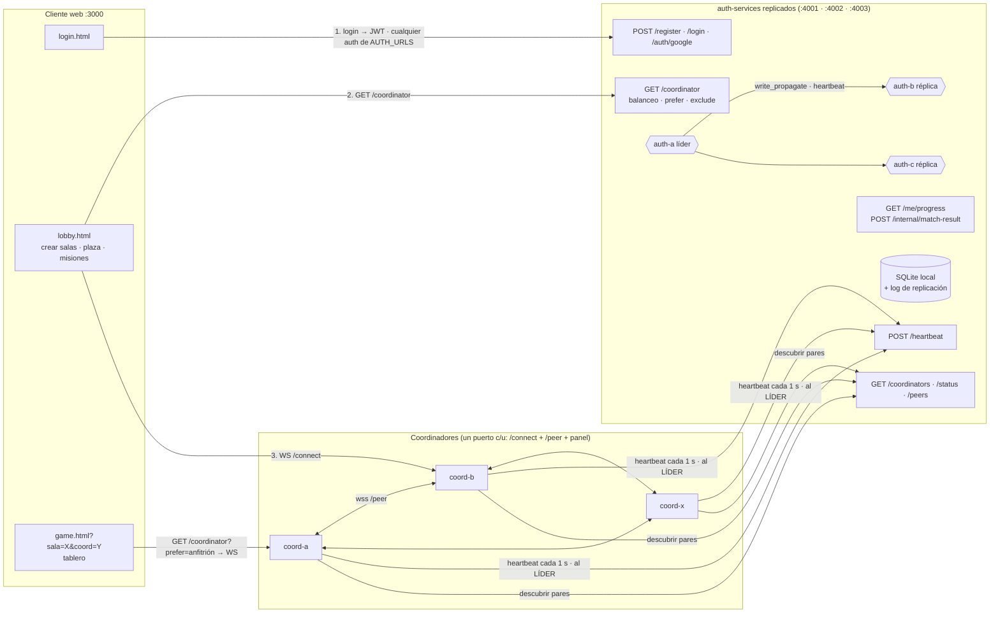

# Cuatro Mundos — Monopoly SD (Proyecto final · Sistemas Distribuidos)

Juego de tablero multijugador en tiempo real. Cuatro mundos comparten el tablero: **Star Wars** (David), **Fantasía** (Jossef), **Vikingos** (Sebastian) y **Literatura** (Santiago). Las **salas las crean los jugadores** y las atiende una red de **X coordinadores en mesh** que puede crecer en caliente.

- **Salas dinámicas**: cualquier jugador crea una sala desde el lobby. La sala queda alojada en su coordinador y se ve desde **todos** los coordinadores.
- **Cambio automático de coordinador**: quien entra a una sala alojada en otro coordinador se cambia solo al anfitrión. Esto vale tanto para jugar como para observar.
- **Balanceo de carga**: el auth-service manda a cada jugador al coordinador menos cargado y reparte los empates por turnos (10 jugadores y 2 coordinadores quedan 5 y 5). **Cada vez que entra o sale un coordinador, recalcula las cargas y vuelve a repartir** a los jugadores del lobby en 1–2 s.
- **Replicación y tolerancia a fallos**: todas las salas y jugadores se replican. Si el anfitrión de una sala cae, otro coordinador la adopta con su estado.
- **Panel del coordinador**: al arrancar se abre una página con los demás coordinadores de la red y el estado del enlace con cada uno.
- **Auth-service replicado (Taller 7)**: tres auth-services, **un líder y dos réplicas** (*single-writer replication*). Solo el líder escribe; las réplicas copian su log y atienden lecturas. Si el líder muere, las réplicas eligen otro en ~7–9 s y el sistema sigue aceptando registros. Clientes y coordinadores usan una **lista** `AUTH_URLS` y se reorientan solos. Ver [§13](#13-auth-service-replicado-taller-7).

> **Tutorial para conectar X coordinadores con ngrok:** [`docs/COORDINADORES_NGROK.md`](docs/COORDINADORES_NGROK.md)

---

## 1. Arquitectura



| Componente | Responsabilidad |
| --- | --- |
| `auth-service/` | Usuarios (bcrypt + JWT + Google). **Directorio de coordinadores y balanceador**: recibe heartbeats, descarta los que llevan más de 3 s sin latir (o que se despiden con `/leave`), **rebalancea** cuando cambia la red y responde `/coordinator`, `/coordinators` y `/coordinator-peers`. Guarda el progreso de misiones. **Se corre replicado** (3 procesos): un líder que escribe y réplicas que copian su log (ver §13). |
| `coordinator/` | Atiende a sus clientes por WS, forma la mesh con los demás coordinadores, aloja las salas que crean sus jugadores, replica todo y corre la plaza a 20 Hz. Abre su **panel** en el navegador. |
| `client/` | Login, lobby (crear y listar salas, plaza en canvas, jugadores en línea, colección) y tablero. Pide coordinador al auth antes de abrir cada WS y se reconecta o se cambia de coordinador solo. |

---

## 2. Estructura del repositorio (programación modular)

```text
auth-service/
  index.js                     Arranque: monta las rutas y el clúster
  src/config.js                Línea de comandos (--id, --port, --cluster…) + .env
  src/db.js                    SQLite local (usuarios, progreso, partidas) + log de replicación + term/voto
  src/cluster.js               Mesh de auths: líder/réplica, propagación con ACK, sync, elección
  src/routes/cluster.js        /status · /peers + guardas leaderOnly / freshRead
  src/routes/auth.js           /register · /login · /auth/google
  src/routes/directory.js      /heartbeat · /leave · /coordinator (balanceo y rebalanceo) · /coordinators · /coordinator-peers
  src/routes/progress.js       /me/progress · /internal/match-result
  src/panel.js · src/events.js API del panel del auth y eventos recientes
  panel/index.html · panel.css · panel.js     Panel del auth (rol, term, elecciones, BD, log)

coordinator/
  index.js                     Arranque
  src/config.js                Línea de comandos + .env
  src/state.js                 Estado en memoria y utilidades de envío
  src/server.js                HTTP: panel, /status, WS /connect, WS /peer
  src/clients.js               WebSocket de los jugadores y sus mensajes
  src/mesh.js                  Enlaces con otros coordinadores y réplica
  src/rooms.js                 Salas creadas por jugadores (anfitrión, réplica, timers, adopción)
  src/broadcast.js             Difusión a los clientes locales
  src/loop.js                  Game loop de la plaza (20 Hz)
  src/directory.js             Heartbeat (al líder) y descubrimiento de pares
  src/auth.js                  Cliente de AUTH_URLS: fallback y seguimiento del líder
  src/ngrok.js                 Detecta (o lanza) el túnel de ngrok
  src/panel.js                 API del panel y apertura del navegador
  panel/index.html · panel.css · panel.js     Panel del coordinador
  game/                        Motor del juego (no depende de red)

client/
  server.js                    Sirve public/ y genera /js/config.js
  public/login.html · lobby.html · game.html   Solo marcado (sin CSS ni JS en línea)
  public/css/                  styles.css (base) · login.css · lobby.css · game.css
  public/js/lib/               auth.js (AUTH_URLS + insignia) · dom.js · net.js · tokens.js · sounds.js (compartidos)
  public/js/pages/             login.js · lobby.js · game.js (uno por página)

docs/  COORDINADORES_NGROK.md · ECONOMIA.md · PLANTILLAS.md
```

---

## 3. Cómo correrlo en local

Requisitos: **Node.js 18+**. Usen la misma `JWT_SECRET` en `auth-service/.env` y `coordinator/.env`.

```bash
# 0) Dependencias (una vez)
cd auth-service && npm install && cd ..
cd coordinator  && npm install && cd ..
cd client       && npm install && cd ..

# 1) Tres auth-services replicados (una terminal por cada uno)
cd auth-service && npm run start:a           # auth-a · http://localhost:4001 · mesh ws://localhost:4101
cd auth-service && npm run start:b           # auth-b · http://localhost:4002 · mesh ws://localhost:4102
cd auth-service && npm run start:c           # auth-c · http://localhost:4003 · mesh ws://localhost:4103
#    Cada auth abre su panel (http://localhost:4001/ …) — con --no-panel no lo abre.
#    A los ~7 s uno queda como leader:  curl http://localhost:4001/status
#    (npm start sigue levantando un solo auth en :4000, como en talleres anteriores;
#     en ese caso usen AUTH_URLS=http://localhost:4000 en cliente y coordinadores)

# 2) Coordinadores (una terminal por cada uno; cada uno abre su panel)
cd coordinator && npm run start:a            # coord-a · http://localhost:5001
cd coordinator && npm run start:b            # coord-b · http://localhost:5002
cd coordinator && npm run start:c            # coord-c · http://localhost:5003

# 3) Cliente web
cd client && npm start                       # http://localhost:3000
```

Cualquier otro coordinador: `node index.js --id coord-x --port 5004`. Con ngrok: `node index.js --id coord-x --port 5004 --ngrok`. Todas las opciones están en el [tutorial](docs/COORDINADORES_NGROK.md#8-referencia-de-opciones-del-coordinador).

| Servicio | Variable | Por defecto | Uso |
| --- | --- | --- | --- |
| auth | `PORT`, `JWT_SECRET`, `JWT_EXPIRES_IN`, `DB_PATH`, `GOOGLE_CLIENT_ID` | | Igual que en talleres anteriores |
| auth | `--id`, `--port`, `--peer-port`, `--public-url`, `--peer-url` | `auth-<port>`, `4000`, `port+100`, `http://localhost:<port>`, `ws://localhost:<peer-port>` | Identidad del nodo. `--public-url` es la `leaderUrl` que se entrega a los demás |
| auth | `--cluster` / `AUTH_CLUSTER` | (vacío = nodo único) | `auth-a=ws://…:4101,auth-b=ws://…:4102,auth-c=ws://…:4103`. La **misma** lista en los tres |
| auth | `--db`, `--seed` | `data/<id>.db`, — | BD local del nodo · BD heredada para sembrar un nodo nuevo (los scripts usan `users.db`) |
| auth | `--no-panel` / `OPEN_PANEL=0` | | No abrir el panel del auth en el navegador al arrancar |
| auth | `LEADER_HEARTBEAT_MS`, `ELECTION_TIMEOUT_MS`, `ELECTION_JITTER_MS` | `2000`, `6000`, `1500` | Latido del líder · sin latido este tiempo → elección · azar para evitar empates |
| auth | `WRITE_ACK_TIMEOUT_MS`, `LAG_TOLERANCE` | `3000`, `10` | Espera de ACK de la mayoría (opción B) · atraso máximo para leer en una réplica |
| auth | `HEARTBEAT_TTL_MS` | `3000` | Sin heartbeat durante este tiempo → coordinador muerto |
| auth | `REBALANCE_WINDOW_MS`, `REBALANCE_COOLDOWN_MS` | `30000`, `1000` | Tiempo que se sigue rebalanceando tras un cambio en la red / pausa mínima entre planes |
| coordinator | `--id`, `--port`, `--auth-urls`, `--public-url`, `--ngrok`, `--no-panel` | | Ver tutorial §8 |
| coordinator | `--auth-urls` / `AUTH_URLS` | `http://localhost:4001,…4002,…4003` | Lista de auths (también acepta `--auth-url` / `AUTH_URL` con una o varias URLs) |
| coordinator | `TURN_TIMEOUT_MS`, `MAX_ROOMS`, `ROOM_EMPTY_MS`, `ROOM_ABANDON_MS` | `90000`, `24`, `60000`, `90000` | Tiempo por turno, límite de salas, borrar sala vacía o abandonada |
| client | `PORT`, `AUTH_URLS`, `GOOGLE_CLIENT_ID` | `AUTH_URLS=http://localhost:4001,…4002,…4003` | El cliente **no tiene** URL de coordinador fija. `AUTH_URL` (una sola) sigue funcionando |

---

## 4. Endpoints del directorio (auth-service)

> Con el auth replicado (§13), `POST /heartbeat` y `POST /leave` los atiende **solo el líder** (una réplica responde `503 not_leader` con la `leaderUrl`). `GET /coordinator` y `GET /coordinators` los responde **cualquier** auth: las réplicas reciben una copia del directorio del líder cada 2 s. Los ejemplos usan `:4000` (nodo único); en clúster sirven igual contra `:4001`–`:4003`.

### `POST /heartbeat` — cada coordinador, cada 1 s

```bash
curl -X POST http://localhost:4000/heartbeat -H "Content-Type: application/json" \
  -d '{"coordinatorId":"coord-a","publicUrl":"wss://a.ngrok-free.app","peerUrl":"wss://a.ngrok-free.app/peer","connectedPlayers":7,"lobbyPlayers":5,"uptime":12345}'
# 200 {"ok":true}
# 200 {"ok":true,"rebalance":{"moves":[{"coordinatorId":"coord-a","count":3}]}}   ← orden de rebalanceo
```

`lobbyPlayers` son los jugadores que se pueden mover: están en el lobby, no dentro de una sala.

### Rebalanceo cuando cambia la red

Cada vez que **entra** un coordinador (nuevo o que vuelve) o **sale** uno (por TTL o con `POST /leave`), el directorio recalcula las cargas durante 30 s:

1. Espera a tener **datos frescos**: que todos los coordinadores hayan latido después de la última asignación, para no decidir con cifras viejas.
2. Calcula **un plan global**. El ideal es `total / N` por coordinador. Cada coordinador por encima del techo mueve su exceso a los que están por debajo del piso. Por ejemplo, con A=3 y B=3, si entra C queda A: 1 → C y B: 1 → C.
3. Entrega a cada coordinador su parte en la respuesta de su siguiente heartbeat.
4. El coordinador cierra a esos jugadores con **`4011 move:<destino>`**, empezando por los que llegaron más recientemente. El cliente se reconecta a ese destino y el lobby avisa *"Balanceo de carga: te movemos de B a A…"*.

Tiempos medidos en local: cae A → todos en B en 0,5 s · vuelve A → 3/3 en 1,8 s · entra C → 2/2/2 en 1,9 s · C se despide → 3/3 en 0,5 s.

### `POST /leave` — un coordinador que se cierra con Ctrl+C

Lleva el JWT de servicio. El directorio lo saca **al instante**, sin esperar el TTL, y rebalancea.

```bash
curl -X POST http://localhost:4000/leave -H "Authorization: Bearer <JWT de servicio>"   # lo hace el coordinador al recibir Ctrl+C
# 200 {"ok":true}
```

### `GET /coordinator` — balanceador de carga

```bash
curl http://localhost:4000/coordinator                    # el menos cargado
curl http://localhost:4000/coordinator?prefer=coord-a     # coord-a si está vivo (anfitrión de la sala)
curl http://localhost:4000/coordinator?exclude=coord-b    # cualquiera menos el que acaba de fallar
# 200 {"coordinatorId":"coord-b","publicUrl":"wss://b.ngrok-free.app"}
# 503 {"error":"no_coordinators_available"}
```

- **Menos cargado**: según los jugadores del último heartbeat más las asignaciones hechas desde entonces (reserva provisional). Así, si 10 clientes entran en el mismo segundo, no van todos al mismo coordinador.
- **Empates por turnos** (round-robin): con carga igual, se alternan.
- **`prefer`**: lo usa el tablero para ir al anfitrión de la sala. Si ese coordinador no está vivo, se aplica el balanceo normal.

### `GET /coordinators` y `GET /coordinator-peers`

`/coordinators` lista todos los vivos con carga, uptime y `lastSeenMsAgo`. Lo usan los coordinadores para descubrir pares y para su panel. `/coordinator-peers` es la versión corta (`coordinatorId`, `peerUrl`). **Antes se llamaba `/peers`**: desde el Taller 7, `GET /peers` lista los **auth-services** del clúster.

### Otros

| Endpoint | Para qué |
| --- | --- |
| `GET /me/progress` (Bearer JWT de usuario) | Estadísticas para las misiones de fichas. |
| `POST /internal/match-result` (Bearer JWT de servicio) | El anfitrión de la sala reporta el resultado de la partida. Es idempotente por `matchId`. |

---

## 5. Protocolo de la mesh

Cada coordinador escucha a sus pares en **`<publicUrl>/peer`**, el mismo puerto y el mismo túnel que los clientes. Cada 1 s pide `/coordinators` y abre conexión hacia los pares que aún no tiene.

**Una sola conexión por par.** Solo el coordinador con el id **menor** (orden lexicográfico) inicia la conexión; el mayor espera. Si aun así llega una conexión de un par con el que ya hay enlace, se cierra la nueva (`4009 duplicate peer link`).

**Handshake.** El primer mensaje en cada sentido es:

```json
{ "type": "hello", "coordinatorId": "coord-a", "auth": "<JWT de servicio>" }
```

El campo `auth` es un JWT `{ role: "coordinator" }` firmado con `JWT_SECRET`. Así, un proceso cualquiera no puede meterse a la mesh ni inyectar estado.

**Mensajes replicados** (todos llevan `origin`):

| Mensaje | Cuándo | Qué hace quien lo recibe |
| --- | --- | --- |
| `intent_replicate` `{userId, intent:{dir}, x, y}` | Un cliente local cambia de dirección | Aplica el intent a su copia del jugador |
| `extras_replicate` `{userId, extras}` | Un cliente local cambia color, ánimo o ficha | Actualiza los extras |
| `player_joined` `{userId, username, x, y, view, roomId, since}` | Un cliente se conecta | Agrega el jugador al mundo |
| `player_left` `{userId}` | Un cliente se desconecta | Lo quita, solo si sigue siendo de ese coordinador |
| `positions_replicate` `{positions:[...]}` | Cada 1 s | Corrige la deriva de posiciones |
| `room_state` `{roomId, writer, meta:{name, emblem, host, createdBy}, state}` | Se crea o cambia una sala | Crea la sala si no la conocía y adopta el estado si su versión es mayor |
| `room_deleted` `{roomId}` | El anfitrión borra una sala | La borra y deja una lápida para no resucitarla |

**Sin bucles de replicación**: nadie retransmite lo que recibe, y se descarta todo mensaje con `origin` propio.

**Al enlazarse**, dos coordinadores se mandan sus jugadores locales y **todas** las salas. **Si un par se cae**, los demás retiran a sus jugadores y los marcan desconectados en las salas.

### Game loop de la plaza (20 Hz)

1. Aplica los intents de **todos** los jugadores (locales y remotos).
2. Hace broadcast del `state` **solo a sus clientes locales**.

---

## 6. Salas creadas por los jugadores

1. **Crear**: en el lobby, el jugador escribe un nombre y elige un emblema. El cliente envía `create_room`. Su coordinador crea la sala (`sala-<hex>`), queda como **anfitrión** y la replica a todos. El creador entra directo al tablero.
2. **Ver**: todos los lobbies, en cualquier coordinador, reciben la sala en `rooms_update` con su anfitrión, estado (**Vacía**, **Sin iniciar**, **En curso**, **Finalizada**), asientos, jugadores y observadores.
3. **Entrar u observar**: el lobby abre `game.html?sala=<id>&coord=<anfitrión>`. El tablero pide `GET /coordinator?prefer=<anfitrión>` y se conecta allá. Si el WS llega a otro coordinador, este responde **`4010 host:<anfitrión>`** y el cliente se cambia solo, con el aviso *"Esta sala la atiende coord-a. Cambiando de coord-b a coord-a…"*.
4. **Reglas**: mínimo 2 y máximo 6 jugadores por sala. Un jugador solo puede estar en una sala activa a la vez, y solo puede tener una sala propia vacía. Hay un máximo de `MAX_ROOMS` salas.
5. **Temporizadores**: el fin de turno, la expulsión de quien no se reconecta en 30 s y la limpieza los corre **el anfitrión**. Una sala sin iniciar que queda vacía se borra a los 60 s. Una partida sin nadie conectado se borra a los 90 s.
6. **Si cae el anfitrión**: cuando ni la mesh ni el directorio lo ven, el **líder** (el coordinador vivo con id menor) adopta la sala, sube la versión y la replica. Los jugadores se reconectan y terminan en el nuevo anfitrión.

**Consistencia**: se replica el **estado completo** de la sala con una versión que solo crece. Si dos coordinadores escriben la misma versión a la vez, gana el `writer` con id menor y todos convergen al mismo estado. Como los jugadores de una sala están en el anfitrión, en la práctica casi todas las escrituras salen de un solo coordinador.

---

## 7. Cliente

1. Login → `GET /coordinator` → WS a `publicUrl/connect?token=…` (`public/js/lib/net.js`). Las peticiones al auth pasan por `public/js/lib/auth.js`, que recorre `AUTH_URLS` y sigue al líder (§13.7). Una **insignia** muestra a qué auth está conectado (`Auth: auth-b (réplica)`): abajo a la izquierda en el login y el lobby, y en la barra superior en el tablero.
2. La UI muestra el coordinador en la barra superior, en la plaza junto a **"Tick: 20 Hz"**, bajo cada ficha del canvas, en la lista de jugadores y en cada sala ("Alojada en coord-a").
3. **Si el WS se cae**, el cliente vuelve a pedir `GET /coordinator?exclude=<el caído>`. Los cierres 4001, 4002, 4003 y 4004 son definitivos. Los cierres 4010 (sala en otro coordinador) y 4011 (rebalanceo) son un **cambio de coordinador**.
4. **Sesión única en toda la mesh**: si el mismo usuario abre sesión en otro coordinador, la vieja se cierra con `4002`.
5. En la sala de espera, si el cliente pierde o cambia de coordinador, recupera su asiento con la misma temática y ficha.
6. **Chat**: el coordinador lo replica con la sala. Además, el cliente guarda una copia por sala (`sessionStorage`) y la une con la que llega, así un cambio de coordinador nunca borra mensajes de la pantalla. Lo que se escribe sin conexión queda en cola y se envía al reconectar.
7. **Tablero**:
   - Hay una vista 3D (inclinada) y una plana; el botón `3D` o la tecla `V` cambian entre ellas.
   - El zoom se hace con la rueda y el tablero se mueve arrastrando. Al soltar, el tablero se vuelve a dibujar a la escala real, así que el texto no se pixela.
   - Los iconos son SVG (`public/js/lib/icons.js`), no emojis.
8. **Mesa**:
   - Pestañas: *Mis títulos* (la que se ve por defecto), una por rival y *Todos*.
   - Los títulos de un mismo grupo de color van en una sola línea, con el contador `2/3`.
   - Un título hipotecado **se voltea** y muestra el reverso con lo recibido y lo que cuesta levantarlo.
   - Tiene scroll propio, y su alto se cambia arrastrando el borde superior.
9. **Logros en vivo**: el coordinador manda en cada estado las estadísticas de la partida en curso, y el cliente las suma a su progreso guardado. Así un logro se avisa en el momento y aparece en el panel *Logros en esta partida*. El auth-service lo guarda al terminar la partida.
10. **Intercambios**: las acciones (Aceptar, Contraofertar, Enviar) están en un pie fijo de la ventana. Así siguen visibles aunque el formulario sea más alto que la pantalla.

---

## 8. Temáticas, fichas y misiones

Cada temática tiene **6 fichas**: una inicial y cinco que se **desbloquean con misiones**. El progreso (partidas jugadas y ganadas, propiedades compradas, construcciones) lo guarda el auth-service y lo reportan los coordinadores al terminar cada partida. El coordinador **valida en el servidor** que la ficha elegida esté desbloqueada.

| Mundo | Ficha inicial | Fichas desbloqueables (misión) |
| --- | --- | --- |
| **Star Wars** — Una Galaxia Muy, Muy Lejana | Casco de Darth Vader | Caza TIE Imperial (jugar 1 partida) · Casco del Capitán Rex, Fase II (comprar 6 propiedades) · Caza Ala-X (jugar 3) · Casco de Boba Fett (construir 5) · Estrella de la Muerte (ganar 2) |
| **Fantasía** — Reinos de Fantasía | Poción Arcana | Sombrero de Merlín (jugar 2) · Espada en la Piedra (construir 5) · Unicornio de Brocelianda (comprar 6) · Santo Grial (jugar 4) · Dragón Ancestral (ganar 2) |
| **Vikingos** — Saga Vikinga | Casco del Jarl | Drakkar (jugar 2) · Mjölnir (construir 6) · Escudo Rúnico (comprar 6) · Lobo Fenrir (jugar 4) · Cuervo de Odín (ganar 1) |
| **Literatura** — Mundos de Papel | Gregorio Samsa en su cama | Marranito de *Rebelión en la granja* (jugar 1) · Mariposas amarillas de Macondo (comprar 6) · Sombrero de Arsène Lupin (comprar 10) · Sísifo y su piedra (jugar 5) · Feto de *Un mundo feliz* (ganar 2) |

Propiedades por lado del tablero:

| Lado | Grupo A | Grupo B | Transporte / Servicio | Donación |
| --- | --- | --- | --- | --- |
| Star Wars | Cantina de Mos Eisley (Tatooine) · Ciudad de las Nubes (Bespin) | Palacio Real de Theed (Naboo) · Ciudad Tipoca (Kamino) · Templo Jedi (Coruscant) | Halcón Milenario | Palacio de Jabba el Hutt |
| Fantasía | Bosque de Brocelianda · Árbol de los Elfos | Torre de Merlín · Ávalon · Castillo de Camelot | Grifo Mensajero / Pozo de los Deseos | Dragón dormido |
| Vikingos | Monasterio de Lindisfarne · Mercado de Hedeby | Aldea de Kattegat · Bifröst · Valhalla | Sleipnir | Odín |
| Literatura | Habitación de Gregorio Samsa · La Aguja Hueca de Lupin | Granja Manor del Sr. Jones · Centro de Incubación de Londres · Macondo | Globo de Phileas Fogg / Biblioteca de Babel | Sísifo |

La moneda son los **Doblones (Đ)**. Las fichas son dibujos SVG propios (`client/public/js/lib/tokens.js`).

---

## 9. Exposición con ngrok

El tutorial completo está en **[`docs/COORDINADORES_NGROK.md`](docs/COORDINADORES_NGROK.md)**. En resumen:

- Reparto recomendado: un PC para los **3 auths** (3 túneles), uno para los **3 coordinadores** (3 túneles) y uno para el **cliente**. Ver el [tutorial §4.0](docs/COORDINADORES_NGROK.md#40-reparto-recomendado-un-rol-por-pc-taller-7).
- PC de auths: `npm run start:a -- --public-url https://<túnel-a>` (igual con `b` y `c`). La mesh entre auths va por `localhost`. En `client/.env`: `AUTH_URLS=https://<túnel-a>,https://<túnel-b>,https://<túnel-c>`.
- Cada integrante: `node index.js --id coord-<nombre> --port 5001 --auth-urls https://<auth-a>,https://<auth-b>,https://<auth-c> --ngrok`. **Un solo túnel por coordinador**, porque la mesh va por `/peer` en el mismo puerto.
- Si ngrok ya está abierto, el coordinador detecta el túnel de su puerto y anuncia `wss://…` sin configurar nada.

---

## 10. Guía de la sustentación

1. **Red de coordinadores (3 min).** Levantar el auth y dos o tres coordinadores. Mostrar el **panel** de cada uno: todos se ven entre sí y aparecen como `enlazado`. `curl <auth>/coordinators` muestra la carga y el último heartbeat.
2. **Balanceo y rebalanceo (3 min).** Abrir 6 pestañas (un usuario por pestaña): quedan 3 y 3. `Ctrl+C` en A: todos pasan a B. Volver a encender A: en 1–2 s quedan otra vez 3 y 3 (la consola del auth muestra `[BALANCE] … Plan: coord-b: 3 → coord-a`). Encender C: quedan 2/2/2.
3. **Crear sala en A y unirse desde B (3 min).** Un jugador en `coord-a` crea "La guarida". Un jugador en `coord-b` la ve con "Alojada en coord-a · al entrar pasarás de coord-b a coord-a". Al pulsar "Unirme", el tablero se conecta a `coord-a`. El panel de `coord-a` muestra a ambos jugadores en la sala.
4. **Observar (1 min).** Un tercero en `coord-b` pulsa "Observar partida" y también se cambia a `coord-a`.
5. **Matar el anfitrión (3 min).** `Ctrl+C` en `coord-a`. Al instante (Ctrl+C avisa con `/leave`; si el proceso muere sin avisar, en 3 s) el auth lo descarta y `coord-b` adopta la sala ("Adopto la sala…" en su panel). Los jugadores se reconectan solos y siguen la partida.
6. **Sumar un coordinador en vivo (1 min).** `node index.js --id coord-x --port 5009`. Aparece en los paneles de todos y empieza a recibir jugadores.

### 10.1 Sustentación del Taller 7 (auth replicado)

Antes de empezar: levantar `start:a`, `start:b`, `start:c` del auth, tres coordinadores y el cliente, y **dejar un jugador moviéndose en la plaza** durante toda la demo (el círculo no debe detenerse: el coordinador valida el JWT sin consultar al auth).

```bash
# Ayuda: estado de los tres auths en una línea
for p in 4001 4002 4003; do curl -s localhost:$p/status; echo; done
```

Lo más visual es el **panel de cada auth** (`http://localhost:4001/`, `:4002/`, `:4003/` en el PC de los auths). Muestra:
- el rol y el term;
- una barra con el tiempo desde el último latido del líder (se pone roja antes de declararlo muerto);
- tarjetas de los tres auths: ★ líder, réplica o caído;
- los usuarios y el log de replicación de la BD local;
- los eventos de elección y votos.

Conviene tener abierto el panel de una réplica mientras se mata al líder.

1. **Tres auths (3 min).** `GET /status` de cada uno: uno dice `"role":"leader"`, los otros dos `"replica"`, y los tres muestran el mismo `users` y `lastAppliedSeq`. `GET /peers` muestra el rol de cada nodo.
2. **Registrar alice (3 min).** Desde la página de login (o `curl -X POST localhost:4002/register -H "Content-Type: application/json" -d '{"username":"alice","password":"1234"}'`). Si le pegan a una réplica, responde `503 {"error":"not_leader","leaderUrl":…}` y el cliente repite contra el líder solo. Luego los tres `/status` muestran `users: N+1`. La consola del líder imprime `Escritura #… confirmada por auth-x → se responde al cliente`.
3. **Matar al líder (2 min).** `Ctrl+C` en su terminal. A los ~6 s las réplicas imprimen `Sin heartbeat de … → líder caído`, una se postula y gana (`★ auth-x es el NUEVO LÍDER (term 2…)`). A los ~10 s, `GET /status` de las dos vivas: una es `leader`. Los coordinadores muestran `Heartbeat aceptado por el líder auth-x` y la insignia del cliente cambia de auth si hace falta.
4. **Registrar bob (4 min).** Igual que alice: el nuevo líder lo acepta y lo propaga a la réplica viva (`users: N+2` en ambas).
5. **Revivir el auth muerto (3 min).** `npm run start:<x>` otra vez. Arranca como réplica, se enlaza, ve que su `lastSeq` está atrasado e imprime `request_sync` → `Sync completo … usuarios: N+2`. `GET /status` muestra `"role":"replica"`: **no recupera el liderazgo**.

Durante todo esto, el jugador de la plaza no se desconecta.

---

## 11. Pruebas

```bash
cd coordinator
npm test            # pruebas del motor (reglas, fichas, serialize/load, resultados)
npm run simulate    # simulación de partidas para validar la economía
```

También se corrió una prueba de punta a punta (auth + 2 coordinadores + clientes WS). Verifica que:

- los dos coordinadores se enlazan por `/peer`;
- el directorio los ve a la vez;
- 10 peticiones a `/coordinator` quedan 5 y 5, y `prefer` funciona;
- una sala creada en A se ve desde B;
- un jugador que entra por B recibe `4010 host:coord-a` y luego juega en A;
- el panel solo responde en local;
- al matar A, B adopta la sala.

**Taller 7** — pruebas de punta a punta con 3 auths, 2 coordinadores y un jugador WS (BDs temporales):

| Escenario | Resultado medido |
| --- | --- |
| Arranque de los 3 auths | A los ~7 s hay un líder (term 1) y dos réplicas; los tres con el mismo `users` |
| `POST /register` contra una réplica | `503 not_leader` + `leaderUrl` → reintento en el líder → `201`, confirmado por 1 réplica; los 3 nodos suben `users` |
| `POST /login` en una réplica al día | `200` con token emitido por la réplica |
| Registro 3 s después de matar al líder | `503 no_leader` (elección en curso) |
| Elección | Nuevo líder en ~7–9 s tras el `Ctrl+C` (term 2) |
| Registro tras la elección vía la réplica | `503 not_leader` → nuevo líder → `201`, propagado |
| Revivir el ex-líder | Vuelve como `replica`, `request_sync` y queda con `users` al día; login en él → `200` |
| Cliente web (`AuthApi`) registrando **mientras** no hay líder | Avisa *"Elección de líder en curso…"* y reintenta; `201` del nuevo líder a los ~8 s |
| Jugador en la plaza durante todo lo anterior | WebSocket abierto todo el tiempo, `state` a 20 Hz sin cortes |
| `GET /coordinator` en una réplica durante la elección | `200` (directorio replicado) |
| Coordinadores | Heartbeat falla con `no_leader` unos segundos y luego `Heartbeat aceptado por el líder auth-x` |

---

## 12. Decisiones y límites conocidos

- **`/heartbeat` es abierto**, como pide el enunciado. La mesh sí exige credencial de coordinador en el `hello`, así que un registro falso no puede inyectar estado. Sí podría anunciar una URL falsa a los clientes.
- **Anfitrión por sala**: mantener a los jugadores de una sala en el mismo coordinador evita casi todos los conflictos de escritura. Aun así es consistencia eventual, no consenso: durante una adopción, una acción simultánea puede descartarse.
- **Enlace mesh**: solo el id menor inicia la conexión. Si su túnel funciona pero el del otro no, el enlace no se forma. El panel lo muestra como `esperando` o `sin enlace` con el último error.
- **Desbalance por salas**: el lobby se reparte por igual, pero los jugadores de una sala se concentran en su anfitrión. Es la regla pedida.
- El estado vive en memoria: mientras quede **al menos un coordinador vivo**, las salas sobreviven. El progreso de misiones persiste en SQLite.
- **Auth replicado: hace falta mayoría.** Con 3 auths el sistema tolera la caída de **uno**. Si caen dos, el que queda no puede ganar una elección (necesita 2 votos): no hay líder, no hay registros y las réplicas no emiten tokens (`503 no_leader`). Es a propósito: evita tener dos líderes si la red se parte. Los jugadores que ya están conectados siguen jugando.
- **Escrituras durante una elección**: fallan unos segundos (`503 no_leader`). El cliente web reintenta solo (hasta ~12 s) y avisa en pantalla; los coordinadores reintentan el heartbeat cada segundo.
- **Log sin compactar**: el log de replicación guarda todas las escrituras desde el principio. Para el tamaño del proyecto es suficiente; un `request_sync` desde 0 manda todo el log.

---

## 13. Auth-service replicado (Taller 7)

Antes, si se caía el auth, nadie nuevo podía entrar y nadie podía pedir otro coordinador: el corazón del sistema era único. Ahora hay **tres auth-services** con **replicación single-writer**: un líder a la vez acepta escrituras; las réplicas copian su log, atienden lecturas y eligen un líder nuevo si el actual muere.

### 13.1 Roles

| | leader | replica |
| --- | --- | --- |
| Escrituras (`/register`, primer `/auth/google`, `/internal/match-result`, `/heartbeat`, `/leave`) | Las aplica, las guarda en el log y las propaga | `503 {"error":"not_leader","leaderUrl":"…"}` · durante una elección `503 {"error":"no_leader"}` |
| Lecturas que emiten token (`/login`, `/auth/google` de un usuario existente) y `/me/progress` | Sí | Sí, si `leaderSeq − mySeq < LAG_TOLERANCE` (10). Si no, `503 not_leader` |
| `GET /coordinator`, `/coordinators` | Sí | Sí, con la copia del directorio que manda el líder |
| Latidos | Manda `heartbeat` cada 2 s | Si pasan 6 s (3 latidos) sin oírlo, inicia una elección |

Un nodo arranca siempre como **réplica**. Si encuentra un líder vivo, lo sigue; si no, a los 6 s (más un azar de hasta 1,5 s) se postula.

### 13.2 Endpoints nuevos

```bash
curl localhost:4001/status
# {"authId":"auth-a","role":"leader","publicUrl":"http://localhost:4001","peerUrl":"ws://localhost:4101",
#  "leaderUrl":"http://localhost:4001","leaderId":"auth-a","term":1,"electionInProgress":false,
#  "knownPeers":["auth-b","auth-c"],"clusterSize":3,"lastAppliedSeq":3,"leaderLastSeq":3,"lag":0,"users":3, …}

curl localhost:4002/peers
# {"peers":[{"authId":"auth-a","publicUrl":"http://localhost:4001","peerUrl":"ws://localhost:4101","role":"leader","connected":true,"lastSeq":3},
#           {"authId":"auth-b",…,"role":"replica","self":true}, {"authId":"auth-c",…,"role":"replica"}]}
```

`knownPeers` son los auths con los que hay enlace en este momento. `users` sube en los tres nodos después de cada registro. Todas las respuestas HTTP llevan las cabeceras `X-Auth-Id` y `X-Auth-Role`: así el cliente sabe a quién le habló.

### 13.3 Protocolo de la mesh de auths

Cada auth escucha a los demás por WebSocket en un **puerto aparte** (`--peer-port`, por defecto `puerto + 100`) y también en `/peer` del puerto HTTP (para usar un solo túnel de ngrok). La lista de nodos es fija (`--cluster`, la misma en los tres). **Inicia la conexión el de `authId` menor** (`auth-a` → `auth-b` y `auth-c`; `auth-b` → `auth-c`). Si llega un enlace duplicado se cierra (`4009`). Todos los mensajes llevan `term`.

| Mensaje | Quién → quién | Para qué |
| --- | --- | --- |
| `hello {authId, role, term, publicUrl, peerUrl, lastSeq, lastTerm, auth}` | primer mensaje, ambos sentidos | Presentarse. `auth` es un JWT `{role:"auth"}` firmado con `JWT_SECRET`: un proceso cualquiera no puede unirse |
| `heartbeat {authId, term, lastSeq}` | líder → réplicas, cada 2 s | "Sigo vivo y voy en `lastSeq`". La réplica atrasada pide sync |
| `heartbeat_ack {authId, term, lastSeq}` | réplica → líder | El líder sabe quién lo oye (y si conserva la mayoría) |
| `write_propagate {term, seq, op, data}` | líder → réplicas | Una escritura. `op`: `register`, `register_google`, `match_result` |
| `write_ack {authId, seq}` | réplica → líder | "Ya apliqué hasta `seq`" (necesario para la opción B) |
| `request_sync {fromSeq, lastTerm}` | réplica → líder | "Tengo hasta `fromSeq`; mándame lo que sigue" |
| `sync_response {entries, reset, lastSeq}` | líder → réplica | Las entradas con `seq > fromSeq` (o todo el log con `reset:true`, ver 13.6) |
| `election {candidate, term, lastSeq, lastTerm}` | candidato → todos | Pedir el voto |
| `vote {voter, term, voteGranted}` | → candidato | Respuesta |
| `new_leader {leader, term}` | ganador → todos | Anuncio |
| `directory {coordinators}` | líder → réplicas, cada 2 s | Copia del directorio de coordinadores (estado blando) |

Ejemplo de propagación de un registro:

```json
{ "type": "write_propagate", "term": 3, "seq": 143, "op": "register",
  "data": { "userId": 28, "username": "alice", "provider": "local",
            "password_hash": "$2b$10$…", "created_at": "2026-11-19T…" } }
```

**Todas las decisiones las toma el líder** (`userId = max(id) + 1`, hash, fecha) y van dentro de `data`. Las réplicas aplican la misma entrada con el mismo `userId`, así los JWT firmados por cualquier nodo llevan el mismo id. Cada nodo guarda su BD y el **log de replicación** (`replication_log`) en `auth-service/data/<id>.db`.

### 13.4 Consistencia de escrituras: elegimos la opción B

> **Propagar primero, responder después.** El líder escribe la entrada en su log, la propaga y **solo responde al cliente cuando la mayoría del clúster la tiene**: él más una réplica en un clúster de 3. Si en `WRITE_ACK_TIMEOUT_MS` (3 s) no llega el ACK, responde `503 replication_timeout`.

Por qué:

1. **Lo que se escribe aquí no se puede reconstruir.** A diferencia de las posiciones de los coordinadores, un usuario registrado es un hecho. Con la opción A, si el líder muere justo después de responder `201`, el usuario cree que tiene cuenta y el sistema no la tiene. Con B, un `201` significa que la cuenta está en al menos dos nodos y sobrevive a la caída de cualquiera.
2. **Encaja con la elección.** Una réplica solo vota por un candidato cuyo log está al menos tan al día como el suyo (13.5). Toda escritura confirmada está en la mayoría y todo ganador necesita votos de la mayoría, así que **el nuevo líder siempre tiene todas las escrituras confirmadas**.
3. **El costo es aceptable.** Las escrituras son raras (registrarse, terminar una partida) y en local el ACK tarda milisegundos. Esperar a *una* réplica, no a todas, evita que una réplica lenta o caída frene el sistema: con 2 de 3 vivos todo sigue funcionando.

El riesgo que aceptamos: si caen **dos** auths, el que queda no consigue ACK y las escrituras fallan con `503` (y a los 6 s deja de ser líder, ver §12). Un `503 replication_timeout` significa "no confirmado": si la entrada sí llegó, el reintento responde `409 ya registrado`; si se perdió junto con un ex-líder aislado, se descarta en el siguiente sync.

### 13.5 Elección de líder

1. Una réplica que no recibe latido en 6 s declara muerto al líder. Espera un azar de 0–1,5 s (para que no se postulen todas a la vez), sube su `term`, vota por sí misma y manda `election`.
2. Cada nodo da **un voto por term** (guardado en la BD) y solo si el log del candidato está al día: `(lastTerm, lastSeq)` del candidato ≥ el propio. Un nodo que todavía oye a un líder vivo no vota; así un nodo que vuelve no tumba al líder actual.
3. Con **mayoría** (2 de 3) el candidato es líder: manda `new_leader` y empieza a latir. Si hay empate, reintenta a los ~2 s.
4. Quien ve un `term` mayor que el suyo lo adopta; si era líder, se baja. Un líder que deja de ver a la mayoría durante 6 s también se baja.
5. El nuevo líder parte del directorio de coordinadores que venía recibiendo, con el TTL reiniciado. Así los coordinadores no desaparecen ni se rebalancean mientras se reorientan hacia él.

**Durante una elección (≈ 6–9 s desde la caída) ninguna escritura se acepta** y las réplicas responden `503 no_leader`. El cliente debe reintentar: el cliente web lo hace solo durante ~12 s y lo avisa en pantalla; los coordinadores reintentan el heartbeat cada segundo. `GET /coordinator` **sí** funciona durante la elección (directorio replicado), y los jugadores conectados no notan nada porque el coordinador valida el JWT sin el auth.

### 13.6 Réplicas atrasadas, sync y nodos que vuelven

- **Lecturas en réplicas atrasadas.** Usamos la recomendación del enunciado: si `leaderSeq − mySeq < 10` (`LAG_TOLERANCE`), la réplica responde; si está más atrás, `503 not_leader` y el cliente va al líder. Además, si una réplica **no encuentra** al usuario y está aunque sea 1 entrada atrás, **no** dice "credenciales inválidas": redirige al líder, porque ese usuario puede ser justo el que todavía no le llegó. Así se evita el falso negativo del enunciado sin mandar todas las lecturas al líder. Con la opción B el atraso normal es 0.
- **Sync.** Una réplica pide `request_sync` cuando el `heartbeat` o un `write_propagate` le muestran un hueco. El líder responde con las entradas que le faltan.
- **Divergencia.** Si una réplica trae entradas que el líder no tiene (por ejemplo, un ex-líder con una escritura que nadie confirmó), el `term` de su última entrada no coincide con el del líder. El líder lo detecta y responde con `reset: true` y el log completo; la réplica borra su BD y la reconstruye. Así todos convergen al log del líder.
- **El auth muerto vuelve** como réplica (guarda su `term` en disco), recibe el `hello` del líder actual y lo sigue: no recupera el liderazgo. Si está atrasado, pide sync.

### 13.7 Clientes y coordinadores

- **Cliente web**: `AUTH_URLS` en `client/.env` (el servidor la entrega en `/js/config.js`). `public/js/lib/auth.js` prueba primero el último auth que respondió, o el líder conocido si es una escritura. Error de red o 5xx → siguiente; `503 not_leader` → repite contra `leaderUrl`; `503 no_leader` → espera 2 s y reintenta. La **insignia** de abajo a la izquierda muestra `Auth: auth-b (réplica)` y, al pasar el mouse, el líder y la lista completa.
- **Coordinadores**: `--auth-urls` / `AUTH_URLS`, con la misma lógica (`coordinator/src/auth.js`). El heartbeat, `/leave` y el resultado de partidas van **al líder**; si cambia, la réplica que contesta les da la nueva `leaderUrl` y se reorientan. La lista de coordinadores la piden a cualquier auth. El panel muestra el auth que respondió y el líder actual.

### 13.8 Datos heredados

Los scripts `start:a|b|c` usan `--seed users.db`: un nodo que arranca **sin** BD copia `users.db` y convierte sus filas en entradas `term 0` del log, en un orden fijo. Como los tres copian el mismo archivo, generan el mismo log y empiezan sincronizados. `users.db` no se modifica. Para empezar de cero, borren `auth-service/data/`.

---

## 14. Tracks del examen final

**Track principal: chat distribuido.** **Track secundario: modo espectador.** Se eligieron dos tracks porque el espectador comparte con el chat la misma infraestructura (el canal de la sala), y el chat sin el espectador no mostraría el caso "lector que no escribe".

### 14.1 Chat distribuido (principal)

- **Canales**: `global` (plaza del lobby, visible desde todos los coordinadores) y `room:<id>` (chat de cada sala). El cliente no elige el canal: el servidor lo deduce de lo que está viendo, así que nadie puede escribir en una sala ajena.
- **Flujo**: `chat_send` → el coordinador local valida, sella con su reloj, guarda en su historial, entrega a sus clientes y replica por la mesh con `chat_replicate`. Los pares **re-validan** (no confían en el otro coordinador), actualizan su reloj y entregan a los suyos. Nadie retransmite lo recibido, así que no hay bucles. Al enlazarse dos coordinadores se intercambian los historiales (`chat_sync`); los duplicados se descartan por id `origin#seq`.
- **Orden (la parte difícil)**: los relojes de pared pueden estar desfasados, así que se usa un **reloj de Lamport** por coordinador. El orden total es `(lc, origin, seq)`. Si Alice (coord-A) y Bob (coord-B) escriben a la vez, ambos mensajes tienen el mismo `lc` y el desempate por id del coordinador es arbitrario pero **igual en todos**: Charlie, en coord-C, ve la misma conversación que los demás. Si un mensaje llega tarde y le toca ir antes de otros ya mostrados, el cliente lo **inserta en su lugar** con un destello. La prueba de punta a punta comprueba que 12 mensajes enviados a la vez desde dos coordinadores quedan en el mismo orden en los tres clientes.
- **Validación**: máximo 200 caracteres (`CHAT_MAX_LEN`), se eliminan caracteres de control e invisibles (RTL, ancho cero), se colapsan espacios y se rechazan mensajes vacíos. El **cliente escapa HTML** porque siempre usa `textContent` (`` se ve como texto).
- **Rate limiting**: cubeta de fichas por usuario (ráfaga de 5, ritmo sostenido de 1 por segundo). Quien insiste mientras está limitado acumula faltas y queda **silenciado 15 s** (`chat_error: rate_limited | muted`, con `retryMs`). Además hay una guardia por socket: más de 60 mensajes WS por segundo (de cualquier tipo) cierra la conexión con `4008`. En la prueba, 40 mensajes seguidos dejan pasar 5, y 1000 `ping` en un segundo cortan el socket.
- **Persistencia mínima**: cada coordinador guarda en memoria los últimos 50 mensajes por canal (`CHAT_HISTORY`). El cliente que se conecta recibe `chat_history`; si cambia de coordinador por rebalanceo o failover, recibe el historial del nuevo, que ya lo tiene replicado. Los canales de sala se borran con la sala.
- **Sonido**: cada mensaje recibido y enviado suena con el instrumento de la temática (`chatIn`, `chatOut`), con un intervalo mínimo para que una ráfaga no sature.
- **Límites conocidos**: el historial es solo en memoria (si caen todos los coordinadores se pierde). El orden es consistencia eventual: un mensaje con retraso de red puede aparecer insertado más arriba. Un mensaje enviado justo cuando se corta el enlace con un par puede no llegar a ese par hasta el siguiente `chat_sync`.

### 14.2 Modo espectador (secundario)

- **Entrada pública**: `spectate.html` (enlace en el login y en el lobby) lista las salas con `GET <coordinador>/rooms` (público) y abre `game.html?sala=…&espectador=1`. El WS es `/connect?view=board&room=<id>&spectator=1` **sin token**.
- **Qué recibe**: `welcome`, la configuración, `game_state` en cada cambio y el chat de la sala. La pantalla es la del tablero con una insignia y una franja **MODO ESPECTADOR**, sin controles de jugador (intercambios, propiedades, elegir ficha).
- **Solo lectura, validado en el servidor**: los espectadores usan un manejador aparte que solo atiende `ping` y `get_game`. `intent`, `game_action`, `extras_update` y `chat_send` se **ignoran** sin tocar el estado ni lanzar errores (un único aviso `spectator_readonly` por conexión). Desde DevTools, `conn.send({type:'intent', intent:{dir:{x:1,y:0}}})` no tiene efecto.
- **No cuentan para el balanceo**: viven en un mapa propio (`spectators`), no en `clients`. El heartbeat reporta solo los jugadores, y `/status` y el panel muestran los espectadores aparte. No se replican por la mesh.
- **Costo y justificación**: un coordinador con 100 jugadores y 1000 espectadores tiene que enviar el estado a 1100. Decisiones:
  1. Los espectadores van al coordinador que **aloja** la sala (redirección `4010`, igual que los jugadores). El trabajo se hace donde ya vive la sala y no hace falta replicar nada.
  2. El estado se serializa **una sola vez** por cambio y se envía el mismo texto a jugadores y espectadores. Se envía solo cuando cambia (no a 20 Hz).
  3. **Tope por coordinador** (`MAX_SPECTATORS`, 150 por defecto): el excedente recibe `4013 spectators full`.
  4. Guardia anti-inundación y ping/pong para sacar conexiones muertas.

  No se hizo un coordinador exclusivo de espectadores porque complicaría la mesh sin ganar nada con este volumen. Atajo documentado: el contador de espectadores anónimos solo lo conoce el anfitrión de la sala.

### 14.3 Subasta de bienes en bancarrota

Cuando un jugador queda en bancarrota (deuda, rendición, tiempo agotado o desconexión de más de 30 s) y siguen quedando **al menos 2 jugadores**, sus propiedades se **subastan una por una**; el dinero y las cartas de salida pasan al acreedor, como antes. Si la partida termina con esa baja, no hay subasta.

- Pueden ofertar todos los jugadores activos y conectados. Oferta mínima Đ10; cada oferta debe superar a la anterior en Đ10 y no puede exceder el dinero de quien oferta. Se puede **pasar** (definitivo para esa propiedad).
- La propiedad se adjudica cuando nadie más puede o quiere superar la oferta, o cuando vence el reloj (20 s para la primera oferta, 10 s tras cada nueva; `AUCTION_OPEN_MS` y `AUCTION_BID_MS`). Sin ofertas, vuelve al banco.
- Es **autoritativa y replicada**: el estado de la subasta va dentro del estado de la sala. El reloj lo corre el anfitrión y, si cae, el nuevo anfitrión lo reprograma al adoptar la sala.
- Durante la subasta el reloj del turno queda en pausa y el resto de acciones se bloquea; al terminar, el turno se reanuda con el tiempo completo.

### 14.4 Cómo demostrarlo

```bash
cd coordinator && npm test      # 34 pruebas: motor, subastas y núcleo del chat
```

1. **Chat**: tres usuarios en tres coordinadores abren el lobby y escriben a la vez. Todos ven el mismo orden. Con una ráfaga de mensajes aparece *"Vas muy rápido"* y luego *"Silenciado"*.
2. **Espectador**: pestaña de jugador y pestaña anónima en `spectate.html` → *Observar*. La del espectador ve moverse al jugador y leer el chat, pero no escribe. Desde su consola, `conn.send({type:'game_action', data:{action:'roll'}})` no hace nada.
3. **Subasta**: en una partida de 3 o más, un jugador con propiedades pulsa *Rendirse*; aparece el panel de subasta para todos, incluidos los espectadores.
