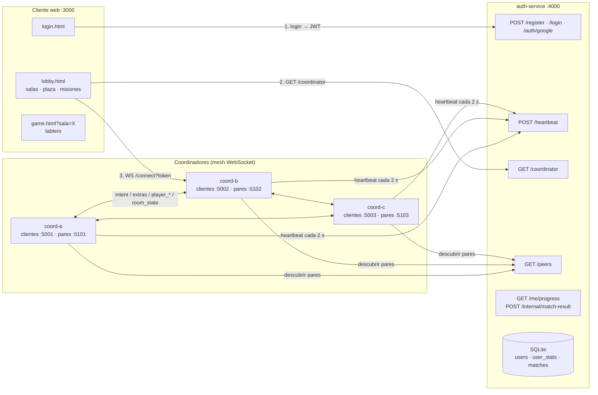

# Cuatro Mundos — Monopoly SD (Proyecto final · Parte III · Taller 6)

Juego de tablero multijugador en tiempo real (Sistemas Distribuidos). Cuatro mundos comparten el tablero — **Piratas** (David), **Fantasía** (Jossef), **Vikingos** (Sebastian) y **Literatura** (Santiago) — y se juega en **3 salas simultáneas** servidas por **varios coordinadores en mesh**.

Este taller elimina el punto único de falla del coordinador:

- **Múltiples coordinadores en paralelo**, todos con el mismo estado del juego e intercambiables.
- **Client-side load balancing**: cada cliente pregunta al auth-service a qué coordinador conectarse y va al menos cargado.
- **Replicación entre coordinadores**: si Alice está en `coord-a` y se mueve, Bob (en `coord-b`) la ve moverse.
- **El cliente muestra a qué coordinador está conectado** y, si se cae, pide otro y se reconecta solo.

---

## 1. Arquitectura



| Componente | Responsabilidad |
| --- | --- |
| `auth-service/` | Usuarios (bcrypt + JWT + Google). **Directorio de coordinadores**: recibe heartbeats, descarta los que llevan > 6 s sin latir, responde `/coordinator` y `/peers`. Guarda el progreso de misiones. |
| `coordinator/` | Atiende a sus clientes por WS, forma la mesh con los demás coordinadores, replica lo que hacen sus clientes, corre el game loop a 20 Hz y aloja las 3 salas de juego. |
| `client/` | Login, lobby (salas, plaza en canvas, jugadores en línea, colección) y tablero. Hace `GET /coordinator` antes de abrir el WS y se reconecta a otro coordinador si el suyo cae. |

---

## 2. Estructura del repositorio

```text
auth-service/index.js        Auth + directorio (heartbeat, coordinator, peers) + misiones
coordinator/index.js         Coordinador: clientes WS, mesh entre pares, salas, game loop
coordinator/game/            Motor del juego (no depende de red; se prueba aislado)
  monopoly.js                Reglas, serialize()/load() para replicar, results() para misiones
  board.js · members.js      Tablero y los cuatro mundos (nombres de propiedades)
  themes.js                  Temáticas, fichas y misiones de desbloqueo
  cards.js · economy.js      Cartas temáticas y balance económico
  monopoly.test.js           Pruebas del motor (node --test)
client/net.js                GET /coordinator + WS + reconexión (compartido por lobby y tablero)
client/tokens.js             Dibujos SVG de las 17 fichas
client/login.html · lobby.html · game.html · game.js · styles.css · game.css
docs/ECONOMIA.md · docs/PLANTILLAS.md
```

---

## 3. Cómo correrlo

Requisitos: **Node.js 18+** (probado con 22). La misma `JWT_SECRET` en `auth-service/.env` y `coordinator/.env`.

```bash
# 0) Dependencias (una vez)
cd auth-service && npm install && cd ..
cd coordinator  && npm install && cd ..
cd client       && npm install && cd ..

# 1) Auth-service + directorio (terminal 1)
cd auth-service && npm start                 # http://localhost:4000

# 2) Tres coordinadores (terminales 2, 3 y 4)
cd coordinator && npm run start:a            # coord-a · clientes 5001 · pares 5101
cd coordinator && npm run start:b            # coord-b · clientes 5002 · pares 5102
cd coordinator && npm run start:c            # coord-c · clientes 5003 · pares 5103

# 3) Cliente web (terminal 5)
cd client && npm start                       # http://localhost:3000
```

Cualquier otro coordinador: `node index.js --id coord-x --port 5004 --peer-port 5104`.

### Variables de entorno

| Servicio | Variable | Por defecto | Uso |
| --- | --- | --- | --- |
| auth | `PORT`, `JWT_SECRET`, `JWT_EXPIRES_IN`, `DB_PATH`, `GOOGLE_CLIENT_ID` | | Igual que en talleres anteriores |
| auth | `HEARTBEAT_TTL_MS` | `6000` | Sin heartbeat durante este tiempo → coordinador muerto |
| coordinator | `--id` / `COORDINATOR_ID` | `coord-<puerto>` | Identificador único en la mesh |
| coordinator | `--port` / `PORT` | `5000` | Puerto de clientes |
| coordinator | `--peer-port` / `PEER_PORT` | `puerto + 100` | Puerto de la mesh (separado del tráfico de clientes) |
| coordinator | `--public-url` / `PUBLIC_URL` | `ws://localhost:<port>` | URL que el auth entrega a los clientes |
| coordinator | `--peer-url` / `PEER_URL` | `ws://localhost:<peer-port>` | URL a la que se conectan los pares |
| coordinator | `--auth-url` / `AUTH_URL` | `http://localhost:4000` | Dónde enviar heartbeats |
| coordinator | `TURN_TIMEOUT_MS`, `DISCONNECT_GRACE_MS`, `ROOM_ABANDON_MS` | `90000`, `30000`, `90000` | Tiempo por turno (al vencer pasa al siguiente) / tiempo para reconectarse antes de salir de la partida / liberar sala abandonada |
| client | `PORT`, `AUTH_URL`, `GOOGLE_CLIENT_ID` | | El cliente **ya no tiene** URL de coordinador fija |

> Si se pasa `--port` por línea de comandos, el coordinador ignora `COORDINATOR_ID`, `PEER_PORT`, `PUBLIC_URL` y `PEER_URL` del `.env`, para que varios coordinadores lanzados desde la misma carpeta no compartan identidad.

---

## 4. Endpoints HTTP nuevos (auth-service)

### `POST /heartbeat` — cada coordinador, cada 2 s

```bash
curl -X POST http://localhost:4000/heartbeat -H "Content-Type: application/json" \
  -d '{"coordinatorId":"coord-a","publicUrl":"ws://localhost:5001","peerUrl":"ws://localhost:5101","connectedPlayers":7,"uptime":12345}'
# 200 {"ok":true}
```

Se guarda en un `Map<coordinatorId, {...info, lastSeen}>`. Un barrido cada segundo descarta los que no han latido en 6 s (3 ciclos). Se validan el id, que las URLs sean `ws://` o `wss://` y que `connectedPlayers` sea un entero ≥ 0 (si no, `400`).

### `GET /coordinator` — el cliente, después del login

```bash
curl http://localhost:4000/coordinator
# 200 {"coordinatorId":"coord-b","publicUrl":"ws://localhost:5002"}
# 503 {"error":"no_coordinators_available"}
```

Devuelve el coordinador vivo con **menos `connectedPlayers`** (empate → el primero). Dos detalles:

- **Reserva provisional**: al asignar un coordinador se le suma 1 a su cuenta en memoria. Así, si 4 clientes entran en el mismo segundo, no van los 4 al mismo antes del siguiente heartbeat (que trae la cifra real).
- **`?exclude=coord-a`** (opcional): el cliente que acaba de perder `coord-a` lo excluye para no volver a él aunque todavía no hayan pasado los 6 s. Si es el único vivo, se ignora el filtro.

### `GET /peers` — los coordinadores, al arrancar y cada 2 s

```bash
curl http://localhost:4000/peers
# {"peers":[{"coordinatorId":"coord-a","peerUrl":"ws://localhost:5101"}, ...]}
```

Cada coordinador filtra su propio id.

### Otros

| Endpoint | Para qué |
| --- | --- |
| `GET /coordinators` | Debug: lista completa con carga, uptime y `lastSeenMsAgo`. |
| `GET /me/progress` (Bearer JWT de usuario) | Estadísticas para las misiones de fichas. |
| `POST /internal/match-result` (Bearer JWT de servicio) | El coordinador reporta el resultado de una partida. Solo acepta tokens con `role: "coordinator"` firmados con `JWT_SECRET`; un token de usuario recibe `401`. Idempotente por `matchId`. |

---

## 5. Protocolo de la mesh

Cada coordinador escucha a sus pares en `peerUrl` (puerto distinto al de clientes). Cada 2 s pide `/peers` y abre conexión hacia los pares que aún no tiene.

**Una sola conexión por par.** Solo el coordinador con el id **menor** (orden lexicográfico) inicia la conexión; el mayor espera. Si aun así llega una conexión de un par con el que ya hay enlace, se cierra la nueva (`4009 duplicate peer link`). Con `coord-a`, `coord-b` y `coord-c`: `a→b`, `a→c`, `b→c`.

**Handshake.** El primer mensaje en cada sentido es:

```json
{ "type": "hello", "coordinatorId": "coord-a", "auth": "<JWT de servicio>" }
```

El campo extra `auth` es un JWT `{ role: "coordinator" }` firmado con `JWT_SECRET`: impide que un proceso cualquiera se meta a la mesh e inyecte estado.

**Mensajes replicados** (todos llevan `origin`):

| Mensaje | Cuándo | Qué hace quien lo recibe |
| --- | --- | --- |
| `intent_replicate` `{origin, userId, intent:{dir}, x, y}` | Un cliente local cambia de dirección | Aplica el intent a su copia del jugador (y corrige la posición con `x, y`) |
| `extras_replicate` `{origin, userId, extras}` | Un cliente local cambia color / ánimo / ficha | Actualiza los extras |
| `player_joined` `{origin, userId, username, x, y, view, roomId, since}` | Un cliente se conecta | Agrega el jugador al mundo |
| `player_left` `{origin, userId}` | Un cliente se desconecta | Lo quita (solo si sigue siendo de ese coordinador) |
| `positions_replicate` `{origin, positions:[...]}` | Cada 1 s | Corrige la deriva de posiciones (ver §8) |
| `room_state` `{origin, roomId, writer, state}` | Cambia una sala | Adopta el estado si su versión es mayor (ver §6) |

**Sin bucles de replicación**: un coordinador **nunca retransmite** lo que recibe (todos los pares lo reciben directo del origen) y descarta cualquier mensaje con `origin` igual a su propio id. `GET /status` de cada coordinador muestra contadores (`replicated`, `received`, `discardedOwnOrigin`).

**Al enlazarse** dos coordinadores se mandan su estado: `player_joined` de cada jugador local y `room_state` de cada sala. Así un coordinador que arranca tarde queda al día.

**Si un par se cae** (se cierra el socket o deja de responder al ping de cada 2 s), los demás retiran del mundo a los jugadores que estaban en él y los marcan desconectados en sus salas.

### Game loop (20 Hz)

1. Aplica los intents de **todos** los jugadores (locales y remotos) a sus posiciones.
2. Hace broadcast del `state` **solo a sus clientes locales** (nunca a los pares). Ese `state` incluye a todos los jugadores del mundo, cada uno con su `coordinatorId`.

---

## 6. Salas de juego y consistencia

Hay **3 salas** (`sala-1` Kraken, `sala-2` Yggdrasil, `sala-3` Babel), cada una con su propia partida: **mínimo 2 y máximo 6 jugadores**. El lobby muestra en vivo, para cada sala, su estado (**Vacía**, **Sin iniciar**, **En curso**, **Finalizada**), los asientos ocupados, quién está dentro, a qué coordinador está conectado cada uno y quién observa. Un jugador solo puede estar en una sala activa a la vez.

El tablero es por turnos y usa azar (dados, cartas): reaplicar la *acción* en cada coordinador daría resultados distintos. Por eso las salas replican el **estado completo** después de cada cambio, con una **versión que solo crece**:

- Se acepta un `room_state` si su versión es mayor que la local.
- Si dos coordinadores escriben la **misma versión** a la vez (dos jugadores actuando en el mismo milisegundo en coordinadores distintos), gana el `writer` con id menor. Todos aplican la misma regla, así que convergen al mismo estado; la acción perdedora se descarta (el jugador la ve revertirse y puede repetirla).
- Los temporizadores de sala (fin del tiempo del turno, sacar a quien no se reconectó en 30 s, liberar una sala abandonada) solo los ejecuta el **líder**: el coordinador vivo con el id menor. Si el líder cae, el siguiente toma el rol.

---

## 7. Cliente

1. Login → `GET /coordinator` → WS a `publicUrl/connect?token=…` (`client/net.js`).
2. La UI muestra **"Coordinador: coord-b"** en la barra superior, en la plaza junto a **"Tick: 20 Hz"**, bajo cada ficha del canvas y en la lista de jugadores en línea. También muestra con qué pares está enlazado su coordinador.
3. **Si el WS se cae, no se reconecta directo al mismo**: vuelve a pedir `GET /coordinator?exclude=<el caído>` y se conecta al que diga el auth. Reintenta con espera creciente si no hay coordinadores. Los cierres por token inválido (4001), sesión duplicada (4002), token manipulado (4003) o sala inválida (4004) son definitivos y llevan al login.
4. **Sesión única en toda la mesh**: si el mismo usuario abre sesión en otro coordinador, la sesión vieja se cierra con `4002`.
5. En la sala de espera, si el coordinador cae, el cliente vuelve a ocupar su asiento con la misma temática y ficha al reconectarse.

---

## 8. Temáticas, fichas y misiones

Cada temática trae **una ficha inicial** y las demás se **desbloquean con misiones**. El progreso (partidas jugadas y ganadas, propiedades compradas, construcciones) lo guarda el auth-service y lo reportan los coordinadores al terminar cada partida. El coordinador **valida en el servidor** que la ficha elegida esté desbloqueada.

| Mundo | Ficha inicial | Fichas desbloqueables (misión) |
| --- | --- | --- |
| **Piratas** — Corsarios del Caribe | Sombrero Pirata | Mapa del Tesoro (jugar 1 partida) · Garfio del Capitán (comprar 8 propiedades) · Calavera y Tibias (ganar 1) |
| **Fantasía** — Reinos de Fantasía | Poción Arcana | Sombrero de Merlín (jugar 2) · Espada en la Piedra (construir 5) · Dragón Ancestral (ganar 2) |
| **Vikingos** — Saga Vikinga | Casco del Jarl | Drakkar (jugar 2) · Mjölnir (construir 6) · Cuervo de Odín (ganar 1) |
| **Literatura** — Mundos de Papel | Gregorio Samsa en su cama | Marranito de *Rebelión en la granja* (jugar 1) · Sombrero de Arsène Lupin (comprar 10) · Sísifo y su piedra (jugar 5) · Feto de *Un mundo feliz* (ganar 2) |

Propiedades por lado del tablero:

| Lado | Grupo A | Grupo B | Transporte / Servicio | Donación |
| --- | --- | --- | --- | --- |
| Piratas | Isla Tortuga · Bahía de Cartagena de Indias | Port Royal · Isla Calavera · Isla del Tesoro de Flint | Galeón Queen Anne's Revenge | Cofre de Davy Jones |
| Fantasía | Bosque de Brocelianda · Árbol de los Elfos | Torre de Merlín · Ávalon · Castillo de Camelot | Grifo Mensajero / Pozo de los Deseos | Dragón dormido |
| Vikingos | Monasterio de Lindisfarne · Mercado de Hedeby | Aldea de Kattegat · Bifröst · Valhalla | Sleipnir | Odín |
| Literatura | Habitación de Gregorio Samsa · La Aguja Hueca de Lupin | Granja Manor del Sr. Jones · Centro de Incubación de Londres · Macondo | Globo de Phileas Fogg / Biblioteca de Babel | Sísifo |

La moneda son los **Doblones (Đ)**. Las fichas son dibujos SVG propios (`client/tokens.js`).

**Corrección de deriva**: cada coordinador integra las posiciones por su cuenta, con su propio `dt`. Para que no se separen, el `intent_replicate` lleva la posición del origen al cambiar de dirección y cada segundo el dueño de cada jugador manda `positions_replicate`.

---

## 9. Exposición con ngrok

Cada proceso que reciben navegadores necesita un túnel: el **cliente**, el **auth** y el **puerto de clientes de cada coordinador**. Los puertos de pares pueden quedarse en `localhost` si los coordinadores corren en la misma máquina.

```bash
ngrok http 3000   # cliente
ngrok http 4000   # auth
ngrok http 5001   # coord-a (repetir para 5002 y 5003)
```

Luego:

```bash
# client/.env
AUTH_URL=https://<auth>.ngrok-free.app

# cada coordinador anuncia su URL pública:
npm run start:a -- --public-url wss://<coord-a>.ngrok-free.app --auth-url https://<auth>.ngrok-free.app
```

Todas las peticiones del cliente y de los coordinadores envían `ngrok-skip-browser-warning`.

---

## 10. Guía de la sustentación

1. **Tres coordinadores en /peers (3 min).** Levantar auth, `start:a`, `start:b`, `start:c`. Mostrar `curl http://localhost:4000/peers` con los tres y, en las consolas, `[MESH] Enlace establecido con …`. `GET /coordinators` muestra carga y último heartbeat.
2. **Distribución de 4 clientes (3 min).** Abrir 4 pestañas (perfiles o ventanas privadas distintas, un usuario por pestaña). Cada lobby muestra su coordinador; la consola del auth registra `GET /coordinator → coord-x`. Quedan repartidos entre los tres.
3. **Alice y Bob en coordinadores distintos (2 min).** Ambas pestañas muestran "Coordinador: …" arriba y junto a "Tick: 20 Hz". Mover a Alice con WASD: Bob la ve moverse en vivo (y viceversa). Bajo cada ficha aparece el coordinador del jugador.
4. **Matar un coordinador (4 min).** `Ctrl+C` en uno de ellos.
   - a. Sus clientes muestran *"Se perdió coord-x. Pidiendo un nuevo coordinador…"*.
   - b. Tras > 6 s, el auth registra `[DIRECTORY] coord-x descartado` y `/peers` / `/coordinator` ya no lo devuelven.
   - c. Los clientes se reconectan solos a un coordinador vivo (la UI muestra el nuevo) y siguen viendo a todos.
5. **Extra**: dos jugadores en la misma sala desde coordinadores distintos juegan una partida; el lobby de un tercero la muestra "En curso".

---

## 11. Pruebas

```bash
cd coordinator
npm test            # 19 pruebas del motor (reglas, fichas, serialize/load, resultados)
npm run simulate    # simulación de partidas para validar la economía
```

Durante el desarrollo también se corrió una prueba de punta a punta (auth + 3 coordinadores + clientes WS). Verifica que `/peers` lista los tres, que hay una sola conexión por par, que los 4 clientes se reparten, que el movimiento y los extras se replican, que las salas se replican entre coordinadores, que se rechaza una ficha bloqueada, que la partida se reporta una sola vez, que al caer un coordinador el auth deja de devolverlo y que la sesión duplicada se cierra con 4002.

---

## 12. Decisiones y límites conocidos

- **`/heartbeat` es abierto**, como pide el enunciado. La mesh sí exige credencial de coordinador en el `hello`, así que un registro falso no puede inyectar estado. Sí podría anunciar una URL falsa a los clientes; en producción `/heartbeat` también debería pedir el JWT de servicio.
- **Conflictos de sala**: se resuelven con el desempate determinista (versión, luego id menor). Es consistencia eventual, no consenso: una acción simultánea en otro coordinador puede descartarse.
- **Sala de espera**: al desconectarse, el jugador libera su asiento (como en talleres anteriores). El cliente lo recupera solo si la desconexión fue por caída de su coordinador.
- El estado vive en memoria de los coordinadores: mientras quede **al menos uno vivo**, las partidas sobreviven. Si caen todos, se pierden (el progreso de misiones sí persiste en SQLite).
