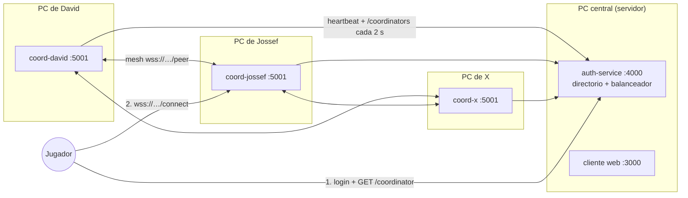

# Tutorial: conectar X coordinadores con ngrok

Esta guía explica cómo armar la red de coordinadores de **Cuatro Mundos** cuando cada integrante corre el suyo en su propio computador y todo se expone a internet con **ngrok**. Al final cualquiera puede sumar un coordinador más con un solo comando, y su panel le muestra los demás coordinadores y si está enlazado con cada uno.

---

## 1. La idea en un dibujo



- **El auth-service es el directorio.** Cada coordinador se anuncia con `POST /heartbeat` cada 2 s y pregunta por los demás con `GET /coordinators`. Si alguno deja de latir durante 6 s, se descarta.
- **Un solo puerto por coordinador.** Los jugadores entran por `/connect` y los demás coordinadores por `/peer`, en el mismo puerto. Por eso **cada coordinador necesita un único túnel de ngrok**.
- **La mesh es completa.** Cada coordinador se enlaza con todos los demás. Entre cada par, el de id menor (orden alfabético) abre la conexión.
- **Balanceo de carga.** `GET /coordinator` devuelve el coordinador con menos jugadores y reparte los empates por turnos. Por ejemplo, 10 jugadores y 2 coordinadores quedan 5 y 5.
- **Salas.** Una sala vive en el coordinador de quien la creó (su *anfitrión*), pero se ve desde todos. Quien entra a jugar u observar desde otro coordinador se cambia solo al anfitrión.

---

## 2. Por qué antes "solo se veía uno"

Antes, los coordinadores no se veían entre sí y aparecían uno a la vez. Había dos causas, y las dos ya están corregidas:

1. **Id repetido.** Sin `--id`, el id era `coord-<puerto>`. Dos personas con el mismo puerto anunciaban el mismo id (`coord-5000`) y el directorio las trataba como un solo coordinador que cambiaba de URL. El otro solo "aparecía" cuando uno se caía. **Ahora** el id por defecto incluye el nombre del equipo (`coord-<pc>-<puerto>`). Aun así, usen siempre `--id coord-<nombre>`.
2. **La mesh iba por otro puerto** (`5101`) que nadie exponía con ngrok, y se anunciaba como `ws://localhost:5101`. Desde otra máquina ese enlace era imposible. **Ahora** la mesh va por el mismo puerto y el mismo túnel (`wss://<tu-túnel>/peer`).

---

## 3. Requisitos (una sola vez)

1. **Node.js 18+** y el repositorio clonado. Instalen dependencias en cada carpeta: `npm install`.
2. **Cuenta de ngrok** (gratis) en <https://dashboard.ngrok.com>. Instalen el agente y registren su token:
   ```bash
   ngrok config add-authtoken <TU_AUTHTOKEN>
   ```
   Compruébenlo con `ngrok version`. El comando `ngrok` debe estar en el PATH.
3. **El mismo `JWT_SECRET` en todos lados**: `auth-service/.env` y el `coordinator/.env` de cada integrante. Con ese secreto los coordinadores se reconocen entre sí. Si no coincide, el panel muestra *"credencial de coordinador inválida"*.

> Cada integrante usa **su propia cuenta de ngrok** en su propio PC. El plan gratis permite un solo agente abierto por cuenta, pero ese agente puede llevar varios túneles (ver §6).

---

## 4. Paso a paso

### 4.1 PC central: auth-service + cliente web

```bash
# Terminal 1
cd auth-service && npm start               # http://localhost:4000

# Terminal 2
cd client && npm start                     # http://localhost:3000
```

Necesita **dos túneles**, uno para el auth y otro para el cliente web. Con un solo agente se hace con un archivo de configuración (ver §6) y `ngrok start --all`. Anoten las dos URLs, por ejemplo:

```
https://auth-abc.ngrok-free.app   → localhost:4000
https://juego-xyz.ngrok-free.app  → localhost:3000
```

En `client/.env` pongan la URL pública del auth y reinicien el cliente:

```env
AUTH_URL=https://auth-abc.ngrok-free.app
```

### 4.2 Cada integrante: su coordinador

En `coordinator/.env` (o por línea de comandos):

```env
JWT_SECRET=<el mismo de todos>
AUTH_URL=https://auth-abc.ngrok-free.app
```

Hay **tres formas** de arrancar. Elijan una:

**A. El coordinador abre su propio túnel (la más simple)**

```bash
cd coordinator
node index.js --id coord-david --port 5001 --ngrok
```

**B. Ustedes abren ngrok y el coordinador lo detecta solo**

```bash
ngrok http 5001                                  # terminal 1
cd coordinator && node index.js --id coord-david --port 5001   # terminal 2
```

El coordinador consulta la API local de ngrok (`http://127.0.0.1:4040/api/tunnels`), encuentra el túnel que apunta a su puerto y anuncia `wss://<túnel>`. No importa si ngrok se abre antes o después.

**C. URL manual** (si ya conocen la URL fija de su túnel)

```bash
node index.js --id coord-david --port 5001 --public-url wss://david.ngrok-free.app
```

### 4.3 El panel del coordinador

Al arrancar, el coordinador **abre solo el navegador** en `http://localhost:5001/`. Ahí se ve:

| Sección | Qué muestra |
| --- | --- |
| **Este coordinador** | id, URL pública (`wss://…`), URL de pares (`wss://…/peer`), auth, jugadores conectados. Si la URL es `localhost`, avisa que nadie de afuera los alcanza. |
| **Coordinadores en la red** | **Todos** los coordinadores que conoce el directorio, con su carga, su último latido y el estado del enlace mesh: `enlazado`, `conectando`, `esperando` (el otro inicia la conexión) o `sin enlace`, más el último error. |
| **Salas** | Salas creadas por los jugadores y qué coordinador aloja cada una. |
| **Jugadores en la mesh** | Cada jugador y el coordinador al que está conectado. |
| **Eventos recientes** | Enlaces, réplicas, salas creadas, adoptadas o borradas. |

Por seguridad, el panel solo responde en la máquina del coordinador: por el túnel devuelve `403`. Para no abrir el navegador, usen `--no-panel`.

Para revisarlo desde la terminal:

```bash
curl https://auth-abc.ngrok-free.app/coordinators     # lo que ve el directorio
curl http://localhost:5001/status                     # pares y salas de un coordinador
```

### 4.4 Sumar el coordinador número X

Es el mismo comando con otro id:

```bash
node index.js --id coord-x --port 5001 --ngrok
```

En unos 2 s:

1. El auth lo registra: `[DIRECTORY] Coordinador registrado: coord-x (wss://…)`.
2. Los demás lo ven en su próximo `GET /coordinators`. Entre cada par, el de id menor abre el enlace: `[MESH] Enlace establecido con coord-x`.
3. Al enlazarse, se mandan los jugadores y **todas las salas**, así el nuevo queda al día.
4. Desde ese momento el balanceador ya le envía jugadores nuevos.

No hay que reiniciar nada ni editar listas de pares.

---

## 5. Cómo se comporta con salas y caídas

| Situación | Qué pasa |
| --- | --- |
| Alguien en `coord-a` crea una sala | La sala queda alojada en `coord-a` y se replica a todos. Los lobbies de todos los coordinadores la muestran con la etiqueta "Alojada en coord-a". |
| Alguien en `coord-b` entra a esa sala | El lobby abre `game.html?sala=…&coord=coord-a`. El cliente pide `GET /coordinator?prefer=coord-a` y se conecta a `coord-a`. Si por algún motivo llega a `coord-b`, este cierra con `4010 host:coord-a` y el cliente se cambia solo. |
| Observar una partida | Funciona igual: el observador también se cambia al anfitrión. |
| Se cae el anfitrión | En unos 6 s el directorio lo descarta. El líder (el coordinador vivo con id menor) **adopta** la sala con su estado completo. Los jugadores se reconectan solos y terminan en el nuevo anfitrión. |
| Sala vacía | Si nadie se une durante 60 s, el anfitrión la borra en todos los coordinadores. Una partida sin nadie conectado se borra a los 90 s. |
| Lobby | Cada jugador va al coordinador con menos carga. |

---

## 6. Varios túneles con un solo agente de ngrok

El plan gratis permite **un solo agente** abierto por cuenta. Para exponer varios puertos desde el mismo PC (auth + cliente, o varios coordinadores para probar), declaren los túneles en el archivo de configuración. `ngrok config edit` lo abre:

```yaml
version: "2"
authtoken: <TU_AUTHTOKEN>
tunnels:
  auth:
    proto: http
    addr: 4000
  cliente:
    proto: http
    addr: 3000
  coord-a:
    proto: http
    addr: 5001
```

```bash
ngrok config check      # valida el archivo
ngrok start --all       # abre todos los túneles a la vez
```

Luego arranquen los coordinadores **sin** `--ngrok`: cada uno encuentra solo el túnel de su puerto (opción B).

> Si `--ngrok` falla con `ERR_NGROK_108`, ya hay otro agente abierto con esa cuenta. Usen este archivo o la opción B.

---

## 7. Problemas frecuentes

| Síntoma (panel o consola) | Causa | Solución |
| --- | --- | --- |
| "Tu URL pública es local" | No hay túnel hacia el puerto del coordinador. | `ngrok http <puerto>` o `--ngrok`. |
| Otro coordinador aparece en `esperando` mucho tiempo | Él debe abrir el enlace (id menor) pero no te alcanza, normalmente porque tu URL es `localhost`. | Abran el túnel de **ese** lado y del tuyo. |
| `credencial de coordinador inválida` | `JWT_SECRET` distinto. | Copien el mismo secreto en todos los `.env`. |
| `conexión a sí mismo (dos coordinadores con el mismo id)` | Dos personas usan el mismo `--id`. | Ids únicos: `coord-<nombre>`. |
| "Directorio: sin conexión" | `AUTH_URL` mal escrita o el túnel del auth está caído. | Revisen `--auth-url` y que `https://<auth>/health` responda. |
| Un coordinador aparece y desaparece | La PC se suspende o la red corta los heartbeats (TTL de 6 s). | Desactiven la suspensión o suban `HEARTBEAT_TTL_MS` en el auth. |
| El navegador muestra la advertencia de ngrok | Visitas directas a la URL del auth o de un coordinador. | Es normal. El juego envía `ngrok-skip-browser-warning` en todas sus peticiones. |

---

## 8. Referencia de opciones del coordinador

| Opción / variable | Por defecto | Uso |
| --- | --- | --- |
| `--id` / `COORDINATOR_ID` | `coord-<pc>-<puerto>` | Identificador único en la mesh. |
| `--port` / `PORT` | `5000` | Puerto único: panel, `/status`, `/connect` (jugadores) y `/peer` (coordinadores). |
| `--auth-url` / `AUTH_URL` | `http://localhost:4000` | Directorio (auth-service). |
| `--public-url` / `PUBLIC_URL` | túnel de ngrok detectado, o `ws://localhost:<puerto>` | URL que se entrega a los jugadores. |
| `--peer-url` / `PEER_URL` | `<publicUrl>/peer` | URL a la que se conectan los otros coordinadores. |
| `--ngrok` / `NGROK=1` | apagado | Lanza `ngrok http <puerto>` automáticamente. |
| `--no-panel` / `OPEN_PANEL=0` | se abre | No abrir el panel en el navegador. |
| `MAX_ROOMS`, `ROOM_EMPTY_MS`, `ROOM_ABANDON_MS`, `ORPHAN_GRACE_MS` | `24`, `60000`, `90000`, `4000` | Límite de salas y tiempos de limpieza y adopción. |
